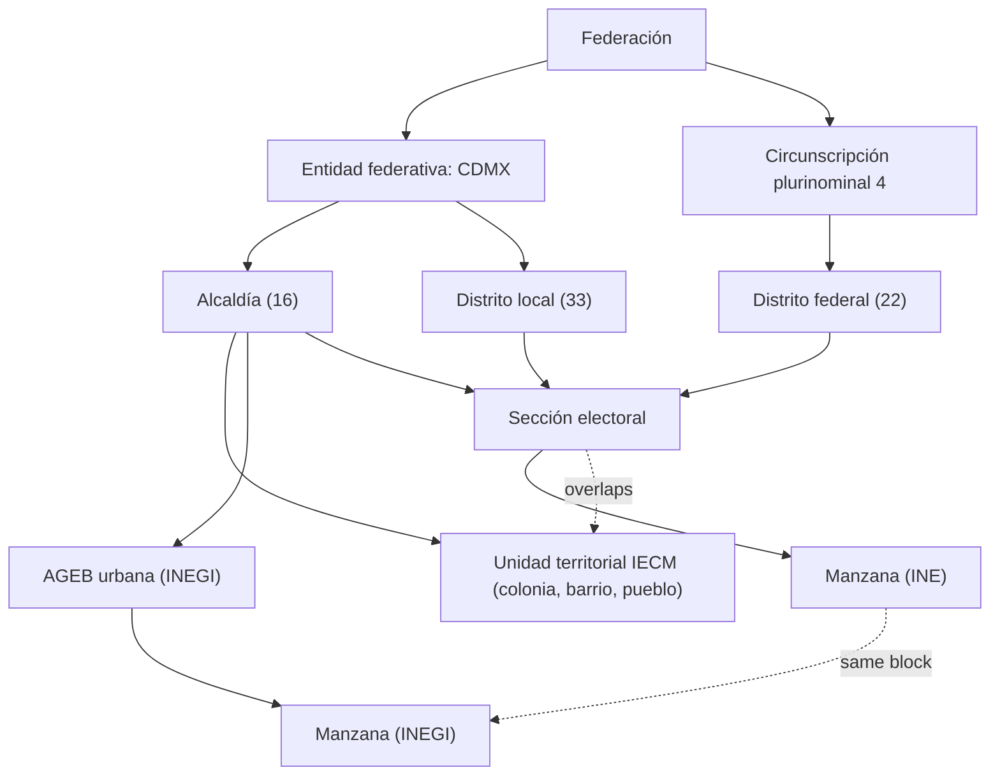

# Jurisdictions and territorial units

Status: proposal. Scope: all of Ciudad de México (CDMX). Demo scope: the *alcaldía* (borough) Cuauhtémoc (2026-10-26).

This document describes the territorial units of CDMX. It also defines how Rogatio stores them.

## 1. Two trees, one atom

Mexico divides its territory in two independent ways:

1. **The government tree.** It describes who governs a place and who must answer a petition.
2. **The electoral tree.** It describes who represents a voter in the legislatures.

The two trees do not nest. A district can cross an *alcaldía* boundary. A *colonia* (neighbourhood) can contain parts of several *secciones electorales* (electoral sections). The *manzana* (city block) is the smallest unit in both trees. It is the common atom.



## 2. Government tree

| Level | CDMX count | Meaning | Legal basis |
|---|---|---|---|
| *Federación* (federal level) | 1 | Legal | Constitution (CPEUM) |
| *Entidad federativa* (federal entity) CDMX | 1 | Legal | CPEUM Art. 122 |
| *Demarcación territorial* / *alcaldía* | 16 | Legal | CPEUM Art. 122 |
| *Unidad territorial* (UT, participation unit) | 1,837 in CDMX; 64 in Cuauhtémoc | Legal, for participation only | Ley de Participación Ciudadana CDMX, Art. 2 |
| *Colonia*, *barrio*, *pueblo* | about 34 named *colonias* in Cuauhtémoc (to verify) | Administrative name, no government of its own | Catalogues of IECM and SEDUVI |
| AGEB (basic geostatistical area) | not counted here | Statistical only | INEGI Marco Geoestadístico |
| *Manzana* (block) | not counted here | Statistical only | INEGI Marco Geoestadístico |

Notes:

- The *alcaldía* is the lowest level with an elected government. In the demo, the Alcaldía Cuauhtémoc receives the Art. 8 petition.
- The *colonia* is **not** the smallest unit. The IECM (CDMX electoral institute) divides large *colonias* into several UTs, for example Roma Norte I, II and III. A UT has two legal functions only. It elects a *Comisión de Participación Comunitaria* (community committee). It receives *presupuesto participativo* (participatory budget).
- AGEB and *manzana* have no legal meaning. INEGI uses them for the census. Rogatio uses them only for maps and statistics.

## 3. Electoral tree

| Level | CDMX count | Defined by |
|---|---|---|
| *Circunscripción plurinominal* (proportional-representation region) | CDMX is in the 4th of 5; the 4th has its seat in CDMX | CPEUM Art. 53; INE |
| *Distrito electoral federal* (federal district) | 22 since the 2021-2023 redistricting (before: 24) | INE |
| *Distrito electoral local* (district of the Congreso CDMX) | 33 | INE |
| *Sección electoral* (electoral section) | 5,535 in CDMX; 389 in Cuauhtémoc (numbers 4523 to 4911) | LGIPE Art. 147 |
| *Manzana* (INE block) | not counted here | INE cartography |

Notes:

- A *sección* has between 100 and 3,000 voters (LGIPE Art. 147). It is the smallest unit with electoral meaning.
- Each *sección* is fully inside one *alcaldía*, one federal district and one local district.
- In Cuauhtémoc, the *secciones* belong to local districts 9 and 12 (to verify against IECM cartography).
- The open-data file maps the Cuauhtémoc *secciones* to federal districts 8 and 12. These values use the districts from before 2023. The current federal districts are 12 and 2 (see [03-representatives.md](03-representatives.md)) (to verify against the current INE file).
- The *sección* counts come from a file with a cut-off date of 2020-12-31. The current counts are (to verify).

### The INE credential gives the join key

LGIPE Art. 156 requires each *credencial para votar* (INE voter credential) to contain the entity, the municipality, the locality and the *sección* of the voter.

- Older credential models print *estado* (state), *municipio* (municipality) and *sección* as separate fields.
- The current model omits *estado*, *municipio* and *localidad* as separate fields. It highlights the *sección*.
- A *sección* number is unique only inside one entity. The key is therefore `(entidad, seccion)`. For CDMX the entity code is `09`.

From `(09, seccion)` Rogatio finds the *alcaldía*, the federal district, the local district and the UTs. The *alcaldía* gives the *alcalde* and the Concejo. The federal district gives a federal deputy. The local district gives a local deputy. The *sección* is therefore the join key from a person to all their territorial representatives.

## 4. Rogatio data model

### Decision

Use **one `jurisdictions` table for both trees** and **a separate `electoral_sections` table as the bridge**. Do not use a general table of typed edges.

```sql
CREATE TYPE jurisdiction_level AS ENUM (
  'federacion', 'entidad', 'alcaldia', 'unidad_territorial',
  'circunscripcion', 'distrito_federal', 'distrito_local'
);

CREATE TABLE jurisdictions (
  id         bigserial PRIMARY KEY,
  level      jurisdiction_level NOT NULL,
  parent_id  bigint REFERENCES jurisdictions(id),
  code       text NOT NULL,          -- official key, e.g. '09-015' or 'DL-12'
  name       text NOT NULL,
  geometry   geometry(MultiPolygon, 4326),
  config     jsonb NOT NULL DEFAULT '{}',
  UNIQUE (level, code)
);

CREATE TABLE electoral_sections (
  entidad              smallint NOT NULL,   -- 9 (INE code '09') for CDMX
  seccion              integer  NOT NULL,
  alcaldia_id          bigint NOT NULL REFERENCES jurisdictions(id),
  distrito_federal_id  bigint NOT NULL REFERENCES jurisdictions(id),
  distrito_local_id    bigint NOT NULL REFERENCES jurisdictions(id),
  districting          text NOT NULL,       -- districting version, e.g. 'INE 2023'
  geometry             geometry(MultiPolygon, 4326),
  PRIMARY KEY (entidad, seccion)
);

CREATE TABLE section_units (               -- sección overlaps UT (many to many)
  entidad   smallint,
  seccion   integer,
  unit_id   bigint REFERENCES jurisdictions(id),
  partial   boolean NOT NULL,
  PRIMARY KEY (entidad, seccion, unit_id),
  FOREIGN KEY (entidad, seccion) REFERENCES electoral_sections
);
```

Each node has one parent **inside its own tree**:

| Level | Parent |
|---|---|
| `entidad` | `federacion` |
| `alcaldia` | `entidad` |
| `unidad_territorial` | `alcaldia` |
| `circunscripcion` | `federacion` |
| `distrito_federal` | `circunscripcion` |
| `distrito_local` | `entidad` |

### Justification

1. **One table keeps one config mechanism.** `resolve_config()` walks `parent_id` in the same way for an *alcaldía* and for a district. A petition to a local deputy inherits the threshold of CDMX.
2. **One table keeps one petition target.** `petitions.jurisdiction_id` can point to any node of either tree.
3. **The trees do not nest, so a node needs no second parent.** The *sección* is the only unit that belongs to both trees. The bridge table states this fact directly.
4. **Typed edges add cost and give no gain.** A general edge table needs recursive queries over mixed edge types. The bridge table needs one indexed lookup.
5. **The *sección* has a different shape.** It has 5,535 rows, a composite natural key and no petition config. It is a lookup table, not a jurisdiction.
6. **AGEB and *manzana* stay out of the model.** They have no authority and no representative. Load them later only if a map needs them.

The `representatives` table ([03-representatives.md](03-representatives.md)) and the `routing` key in `jurisdictions.config` ([02-routing.md](02-routing.md)) refer to these nodes.

### Eligibility rule

A person can sign a petition when the target node is equal to, or an ancestor of, a node of the person's *sección*. Store the person's `(entidad, seccion)`, not the node ids. A redistricting then changes one table, not every person.

## 5. Data sources

| Level | Source | Format | License |
|---|---|---|---|
| *Entidad*, *alcaldía*, AGEB, *manzana* | [INEGI Marco Geoestadístico](https://www.inegi.org.mx/temas/mg/) | SHP | [Términos de Libre Uso de la Información del INEGI](https://www.inegi.org.mx/inegi/terminos.html): commercial use and redistribution allowed with attribution |
| *Alcaldía*, local districts, *secciones* (CDMX) | [Marco Geográfico Electoral, datos.cdmx.gob.mx](https://datos.cdmx.gob.mx/dataset/marco-geografico-electoral) | KML in RAR | CC-BY-4.0 |
| Federal districts, *secciones*, INE *manzanas* | [INE Cartografía Electoral](https://cartografia.ine.mx/) | SHP (to verify) | (to verify) |
| *Unidades territoriales* (IECM *colonias*) with their *secciones* | [Colonias del IECM 2022, datos.cdmx.gob.mx](https://datos.cdmx.gob.mx/dataset/colonias-del-iecm-2022) | SHP, XLSX dictionary | CC-BY-4.0 |

The IECM 2022 file lists, for each UT, the complete and the partial *secciones*. This gives `section_units` with no spatial join.

## Open questions

- Do federal districts 12 and 2 cover all of Cuauhtémoc after the 2023 redistricting? Load the current INE file before the demo.
- Do we show a UT as a petition target in the demo, or only the *alcaldía* and the districts?
- Do we accept old credential models, or do we require the current model?
- Who owns the yearly refresh of the INE and IECM files when the boundaries change?
- Do we store geometry with PostGIS from day one, or only codes for the demo?

## Sources

- [CPEUM (Constitution), Arts. 8, 53 and 122, Cámara de Diputados](https://www.diputados.gob.mx/LeyesBiblio/pdf/CPEUM.pdf)
- [LGIPE, Arts. 147 and 156, Cámara de Diputados](https://www.diputados.gob.mx/LeyesBiblio/pdf/LGIPE.pdf)
- [Ley de Participación Ciudadana de la Ciudad de México, Art. 2 (copy at TECDMX)](https://tecdmx.org.mx/wp-content/uploads/2023/09/06_LPCCDMX.pdf)
- [INE, ABC de la credencial para votar 2022](https://www.ine.mx/wp-content/uploads/2022/10/DERFEABCCREDENCIAL2022.pdf)
- [INE, Geografía electoral 2024 (4th circunscripción, seat in CDMX)](https://ayuda.ine.mx/2024/assets/docs/elecciones/geografia-electoral.pdf)
- [INE, Distritación electoral](https://www.ine.mx/voto-y-elecciones/distritacion-electoral/)
- [Expansión: INE justifies the CDMX redistricting (24 to 22 districts)](https://politica.expansion.mx/cdmx/2021/09/20/el-ine-justifica-el-plan-de-redistritacion-en-la-cdmx-tras-criticas-de-sheinbaum)
- [IECM](https://www.iecm.mx/) and [Congreso de la Ciudad de México](https://www.congresocdmx.gob.mx/)
- Counts for Cuauhtémoc (389 *secciones*, 64 UTs, local districts 9 and 12) come from our own parse of the two datos.cdmx.gob.mx files above.
