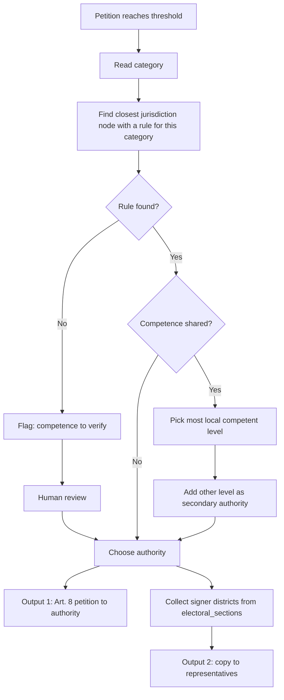

# Petition routing: competence by level

Status: proposal. Scope: all of Ciudad de México (CDMX). Demo scope: the *alcaldía* (borough) Cuauhtémoc (2026-10-26).

## 1. Purpose

This document defines how Rogatio decides where a petition goes.
The input is the petition **category** and the **territory** of the signers.
The output is a list of recipients. Each recipient has a role and a legal basis.

This document is the source of truth for the Art. 8 recipient. [03-representatives.md](03-representatives.md) selects the representatives that get a copy.

Rogatio produces two outputs for each petition that reaches its threshold:

| Output | Recipient | Purpose | Legal effect |
|---|---|---|---|
| 1. Art. 8 petition | The **authority** that can act | Ask for a concrete action | The authority must answer in writing *en breve término* (within a brief term) (CPEUM Art. 8) |
| 2. Copy to representatives | The **representatives** of the signers | Inform and ask for oversight | No legal duty to answer |

The threshold is a product rule. The law does not require a minimum number of signers for an Art. 8 petition.

## 2. Legal basis

### 2.1 Right of petition

CPEUM Art. 8 and Art. 35 fr. V give the right of petition (see the [whitepaper](../whitepaper.md), section 1.2). In political matters, only citizens can petition.

Consequence: the petition must go to the authority that has **competence** (legal power) to act. A wrong authority gives a valid answer: "not my competence". The signers then lose their effort.

### 2.2 Who is competent

| Norm | Rule for routing |
|---|---|
| CPEUM Art. 73 | Lists the powers of the federal Congress, e.g. federal taxes (fr. VII) and general health (fr. XVI). |
| CPEUM Art. 124 | Powers not given expressly to federal officials belong to the states or to CDMX. |
| CPEUM Art. 115 | Regulates *municipios* (municipalities). It does **not** apply to CDMX. Do not cite it for CDMX petitions. |
| CPEUM Art. 122 | CDMX is an autonomous federal entity. *Alcaldías* govern the *demarcaciones territoriales*. Their powers come from the CDMX Constitution and local laws (Art. 122 A fr. VI). |
| *Constitución Política de la CDMX* Art. 25 | Direct democracy. Apartado B: an *iniciativa ciudadana* (citizen bill) needs 0.13% of the CDMX *lista nominal* (voter roll). 0.25% gives a preferential bill. No bills on criminal or tax matters. |
| *Ley Orgánica de Alcaldías de la CDMX* (LOA) | Divides *alcaldía* powers into three types: exclusive (Arts. 30-39), coordinated with the CDMX Government (Arts. 40-57), and subordinated to the CDMX Government (Arts. 58-61) (article ranges to verify against the current text). |
| *Ley de Participación Ciudadana de la CDMX* | Regulates the *iniciativa ciudadana* procedure and the IECM signature check (article numbers to verify). |

### 2.3 *Alcaldía* powers for the demo

- **Exclusive** (LOA Art. 32 fr. IV): street lighting (*alumbrado público*), cleaning and waste collection (*limpia y recolección de basura*), tree pruning, market regulation and paving (*pavimentación*).
- **Exclusive** (LOA Art. 33): rehabilitate and maintain roads, curbs and sidewalks in the *alcaldía*.
- **Exclusive** (LOA Art. 34 fr. VI): build and maintain the public spaces in its charge, for example parks.
- **Coordinated** (LOA Art. 42 fr. VII): water and drainage works, with the CDMX water agency (SACMEX).
- **Subordinated** (LOA Art. 61): public security. The *alcaldía* executes policy and supervises local police commands. The CDMX Government directs the police.
- **Concejo** (borough council, LOA Art. 104): it approves the *alcaldía* budget and programs. It gives opinions on land-use changes. It creates oversight commissions. Rogatio copies the Concejo as a representative body.

Primary roads belong to the CDMX Secretaría de Obras y Servicios (SOBSE). Secondary roads belong to the *alcaldía*. The legal source for this split is the *Ley de Movilidad* and Art. 38 of the CDMX executive organic law (LOAPCDMX) (exact articles to verify).

## 3. Routing table

The representatives column shows who gets a copy. "Signers' district" means each district that the signers' *sección electoral* (electoral section) gives.

| Category | Level | Authority (Art. 8 recipient) | Representatives to copy | Basis | Status |
|---|---|---|---|---|---|
| Potholes, secondary roads | *Alcaldía* | Alcaldía Cuauhtémoc (titular) | Concejo; *diputado local* of signers' district | LOA Arts. 32 fr. IV, 33 | verified |
| Potholes, primary roads | CDMX | SOBSE | *Diputado local* of signers' district | Ley de Movilidad; LOAPCDMX Art. 38 | to verify |
| Street lighting | *Alcaldía* | Alcaldía Cuauhtémoc (titular) | Concejo; *diputado local* | LOA Art. 32 fr. IV | verified |
| Waste collection | *Alcaldía* | Alcaldía Cuauhtémoc (titular) | Concejo; *diputado local* | LOA Art. 32 fr. IV | verified |
| Markets | *Alcaldía* | Alcaldía Cuauhtémoc (titular) | Concejo; *diputado local* | LOA Art. 32 fr. IV | verified |
| Parks, public space | *Alcaldía* | Alcaldía Cuauhtémoc (titular) | Concejo; *diputado local* | LOA Art. 34 fr. VI | verified |
| Water supply, drainage | CDMX (shared) | SACMEX | *Alcalde*; *diputado local* | LOA Art. 42 fr. VII | to verify |
| Public security | CDMX (shared) | Secretaría de Seguridad Ciudadana (SSC) | *Alcalde*; *diputado local* | LOA Art. 61 | to verify |
| Metro | CDMX | Sistema de Transporte Colectivo (STC Metro) | *Diputado local* | Ley de Movilidad (to verify) | to verify |
| Metrobús | CDMX | Metrobús | *Diputado local* | Ley de Movilidad (to verify) | to verify |
| Land use | CDMX (shared) | SEDUVI | *Alcalde*; Concejo; *diputado local* | LOA Arts. 32 fr. VIII, 104 fr. IV | to verify |
| Health services | Shared (federal and CDMX) | Secretaría de Salud de la CDMX | *Diputado local*; *diputado federal* | CPEUM Art. 73 fr. XVI | to verify |
| Basic education | Shared (federal and CDMX) | Federal education authority in CDMX (to verify) | *Diputado federal*; *diputado local* | CPEUM Art. 3, Art. 73 fr. XXV | to verify |
| Federal taxes | Federal | SHCP / SAT | *Diputado federal*; 3 CDMX senators | CPEUM Art. 73 fr. VII | verified |
| Federal laws | Federal | Cámara de Diputados (via the *Mesa Directiva*) and Senado | *Diputado federal*; 3 CDMX senators | CPEUM Arts. 8, 71 fr. IV; Reglamento de la Cámara de Diputados Arts. 132-133 | verified |
| Local laws | CDMX | Congreso de la CDMX | *Diputado local*; competent commission (procedure to verify) | CDMX Const. Art. 25 B | verified |

Notes:

- CDMX has 3 senators: 2 by majority and 1 by first minority (CPEUM Art. 56).
- A petition for a new law is an Art. 8 petition, not a formal citizen bill. A formal bill needs 0.13% of the voter roll (federal: CPEUM Art. 71 fr. IV; CDMX: Const. CDMX Art. 25 B). Rogatio shows the distance to that threshold as information only.
- Signers can live in more than one district. Rogatio sends one copy per district. See [03-representatives.md](03-representatives.md), section 4.

## 4. Shared or unclear competence

Some categories have more than one competent level. Apply these rules in order:

1. Send the Art. 8 petition to the **most local level** that has a legal power in the matter.
2. Cite the norm that gives that power in the petition text.
3. Copy the other competent level as a secondary authority.
4. If no rule matches, set `competence_status = "to_verify"`. The platform shows the flag "competence: to verify". A human reviewer confirms the recipient before Rogatio sends the petition.

The authority can still answer "not my competence". Rogatio then records the answer. It offers to send the petition again to the authority that the answer names.

## 5. Decision flow



## 6. Data structure

### 6.1 Categories catalogue

A new table `categories` holds the catalogue. It holds no routing data.

| Column | Type | Example |
|---|---|---|
| `code` | text, PK | `road.secondary.pothole` |
| `name_es` | text | *Baches en vías secundarias* |
| `parent_code` | text, nullable | `road` |

### 6.2 Competence rules in the jurisdictions tree

Rules live in `jurisdictions.config` (JSONB), under the key `routing`. Resolution uses the same rule as the rest of `config`: **the closest node wins**. The resolver starts at the petition's jurisdiction and moves up the tree until it finds a rule. A rule on the CDMX node applies to all 16 *alcaldías*. A rule on the Cuauhtémoc node overrides it for Cuauhtémoc only.

```json
{
  "routing": {
    "road.secondary.pothole": {
      "level": "alcaldia",
      "authority": {"name": "Alcaldía Cuauhtémoc", "title": "Persona titular de la Alcaldía"},
      "secondary_authorities": [],
      "representatives": ["concejo", "congreso_cdmx"],
      "legal_basis": ["LOA art. 32 fr. IV", "LOA art. 33"],
      "competence_status": "verified"
    }
  }
}
```

The `representatives` values are `representatives.chamber` values ([03-representatives.md](03-representatives.md)). The resolver selects the holder for each signer district.

The resolver also accepts a rule on a parent category code, for example `road`. A rule for the exact code wins over a rule for a parent code.

### 6.3 Resolver signature

```python
from typing import Literal
from pydantic import BaseModel

class Recipient(BaseModel):
    role: Literal["authority", "secondary_authority", "representative"]
    name: str
    title: str
    jurisdiction_id: int          # node that owns the office (alcaldía, CDMX, federal, district)
    legal_basis: list[str]        # e.g. ["LOA art. 32 fr. IV"]
    signer_count: int | None      # representatives only: signers in their district
    competence_status: Literal["verified", "to_verify"]

def route(petition: Petition) -> list[Recipient]:
    """Return the authority first, then secondary authorities, then representatives."""
```

`route()` reads the category rule (section 6.2). Then it reads the signers' `(entidad, seccion)` rows in `electoral_sections` to find `alcaldia_id`, `distrito_federal_id` and `distrito_local_id`. When the petition reaches its threshold, Rogatio stores the result with the petition. The Art. 8 PDF uses the `authority` recipient. The copies use the `representative` recipients.

## Open questions

- Who reviews petitions that have the flag "competence: to verify" during the pilot: the team, or a volunteer lawyer?
- Does Rogatio copy all representatives of all signer districts, or only districts above a minimum share of signers?
- Do we send to the Concejo as a body (through the *alcaldía*) or to each *concejal* by name?
- For the demo, do we limit categories to the verified *alcaldía* rows (potholes, lighting, waste, markets, parks)?
- Which norms give competence for Metro, Metrobús, SACMEX and SOBSE? A lawyer must confirm the exact articles before launch.

## Sources

- *Constitución Política de los Estados Unidos Mexicanos* (Arts. 8, 35, 56, 71, 73, 115, 122, 124), Cámara de Diputados: https://www.diputados.gob.mx/LeyesBiblio/pdf/CPEUM.pdf
- *Ley Orgánica de Alcaldías de la Ciudad de México* (Arts. 19, 29-35, 40-42, 58-61, 104), copy hosted by Alcaldía Iztacalco. This copy is the 2018 text; check the current consolidated version (to verify): https://www.iztacalco.cdmx.gob.mx/pdf/normatividad/LEY_ORGANICA_ALCALDIAS_CDMX.pdf
- *Reglamento de la Cámara de Diputados* (Arts. 132-133): https://www.diputados.gob.mx/LeyesBiblio/pdf/Reg_Diputados.pdf
- *Constitución Política de la Ciudad de México*, Art. 25 (unofficial copy; check against the Congreso CDMX text): https://leyes-mx.com/constitucion_ciudad_de_mexico/25.htm
- Primary and secondary roads split (press, secondary source): https://www.chilango.com/noticias/vias-primarias-secundarias-quien-debe-tapar-los-baches-en-la-cdmx/
- *Ley de Participación Ciudadana de la CDMX* and *Ley de Movilidad de la CDMX*: official URLs not confirmed (to verify).
