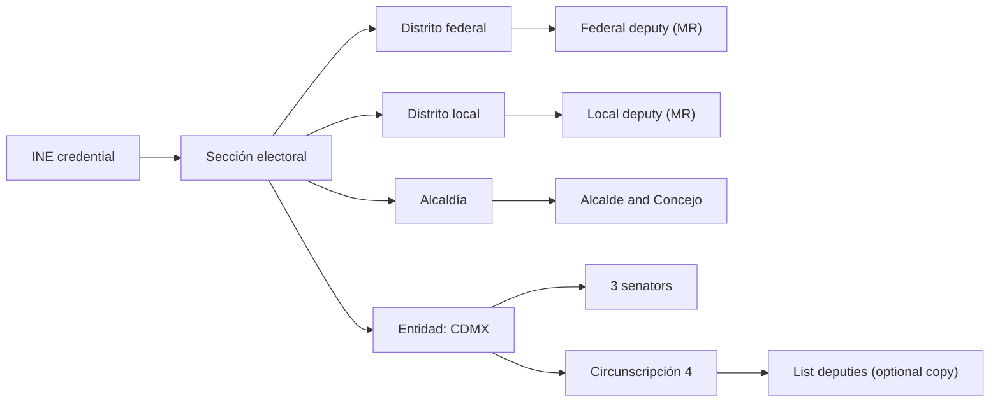

# Representatives: who receives the petition

Status: proposal. Scope: all of Ciudad de México (CDMX). Demo scope: the *alcaldía* (borough) Cuauhtémoc (2026-10-26).

## 1. Purpose

This document defines three things:

- The list of elected representatives that Rogatio stores.
- The mapping from a signer's *sección electoral* (electoral section) to those representatives.
- The rule that selects which representatives get a copy of each petition.

[02-routing.md](02-routing.md) selects the Art. 8 recipient (the authority). This document does not change that choice.

CPEUM Art. 8 requires a petition *por escrito* (in writing). The authority must give a written answer. Each recipient therefore needs a verified official delivery channel.

## 2. Who represents a CDMX resident

| Office | Count | Election principle | Territorial unit | Source law |
|---|---|---|---|---|
| *Diputado federal* (federal deputy), majority | 300 | *mayoría relativa* (first past the post) | *distrito federal* (federal district) | CPEUM Art. 52 |
| *Diputado federal*, list | 200 | *representación proporcional* (proportional list) | *circunscripción* (5 regions) | CPEUM Art. 52, 53 |
| *Senador* (senator), per entity | 3 per entity | 2 *mayoría* + 1 *primera minoría* (first minority) | entity (CDMX) | CPEUM Art. 56 |
| *Senador*, national list | 32 | proportional list | one national *circunscripción* | CPEUM Art. 56 |
| *Diputado local* (Congreso CDMX) | 66 | 33 *mayoría* + 1 migrant seat + 32 proportional | *distrito local* (local district) | CDMX Constitution Art. 29 |
| *Alcalde* (mayor) | 1 per *alcaldía* | *planilla* (slate) vote | *alcaldía* | CDMX Constitution Art. 53 |
| *Concejal* (borough councillor) | 10, 12 or 15 per *alcaldía* (by population) | about 60% slate, 40% proportional (to verify) | *alcaldía* | CDMX Constitution Art. 53 |

CDMX belongs to *circunscripción* 4. The SITL list shows CDMX list deputies as "Circ. 4". CDMX has 22 federal districts and 33 local districts ([01-jurisdictions.md](01-jurisdictions.md)).

### Cuauhtémoc in the current legislatures

| Office | Unit | Holder (2024-2027) | Evidence |
|---|---|---|---|
| Federal deputy (LXVI) | Federal district 12 (most of Cuauhtémoc, Centro Histórico) (to verify coverage) | Mónica Elizabeth Sandoval Hernández | SITL, Wikipedia |
| Federal deputy (LXVI) | Federal district 2 (north strip of Cuauhtémoc, part of Gustavo A. Madero) (to verify coverage) | José Alberto Benavides Castañeda | SITL, Wikipedia |
| Local deputy (III Legislatura) | Local district 9 (to verify coverage) | Iliana Ivón Sánchez Chávez | Congreso CDMX |
| Local deputy (III Legislatura) | Local district 12 (to verify coverage) | Leonor Gómez Otegui | Congreso CDMX |
| *Alcaldesa* | Cuauhtémoc | Alessandra Rojo de la Vega | IECM result (press) |
| *Concejales* | Cuauhtémoc | 15 seats (to verify; population 545,884) | Congreso CDMX, Expansión |

The local district evidence is indirect. In 2024 the IECM recounted the Cuauhtémoc vote in local district councils 9 and 12. The team must confirm the exact local districts with IECM cartography.

## 3. Mapping a signer to representatives

The `electoral_sections` table already holds `alcaldia_id`, `distrito_federal_id` and `distrito_local_id` ([01-jurisdictions.md](01-jurisdictions.md)). One lookup gives every territorial representative.

Rules:

- The INE *sección* is the only input. Rogatio does not ask for an address.
- A *sección* belongs to exactly one federal district and one local district.
- A redistricting changes the mapping. The `electoral_sections.districting` column stores the version, for example `INE 2023`.

## 4. Which representatives get a copy

**Question:** copy the district deputy, the *grupo parlamentario* (parliamentary group), or a *comisión* (commission)?

**Recommendation:**

1. **Main copy: the district deputy (*mayoría relativa*).** This deputy represents the signer's territory. The signer count is meaningful to this person.
2. **For legislative requests, also reach the competent ordinary commission.** The *Reglamento de la Cámara de Diputados* sends petitions to the *Mesa Directiva* (Art. 132). The *Mesa Directiva* sends legislative petitions to the competent commission (Art. 133). Commissions write the *dictámenes* (reports) ([LOCGEUM Art. 39](https://www.diputados.gob.mx/LeyesBiblio/pdf/LOCGEUM.pdf)).
3. **Never send to a *grupo parlamentario*.** The law defines it as "el conjunto de diputados según su afiliación de partido" (deputies grouped by party) (LOCGEUM Art. 26). It is a party body, not a territorial one. It has no duty to answer as an authority. A copy to it makes Rogatio look partisan.

The petition type decides the recipient set. The Art. 8 recipient column repeats [02-routing.md](02-routing.md):

| Petition type | Art. 8 recipient (from 02-routing) | Representatives to copy |
|---|---|---|
| *Alcaldía* service (paving, lighting) | Alcaldía (titular) | Concejo; local district deputy |
| CDMX law or budget | Congreso de la CDMX | Local district deputy; competent Congreso CDMX commission (procedure to verify) |
| Federal law | Cámara de Diputados (via the *Mesa Directiva*, with a request to send it to the commission) and Senado | Federal district deputy; 3 CDMX senators |
| Federal topic for the whole entity, for example federal taxes | Competent federal authority, for example SHCP / SAT | Federal district deputy; 3 CDMX senators |

### Signers in several districts

1. Group verified signatures by district.
2. Produce one copy per district representative.
3. Each copy states that district's signer count and the total count.
4. Apply the threshold to the total. Do not apply it per district.
5. Store one delivery record per copy.

Example: 800 signers in federal district 12 and 120 in federal district 2 give two copies. Each copy shows its own count and the total of 920.

### List deputies

List (*plurinominal*) deputies have no district. Rogatio offers them as an optional copy only. The petition author selects them. Default: off.

## 5. Data sources

| Source | Data | Format | Method |
|---|---|---|---|
| Cámara de Diputados, SITL | 500 federal deputies, entity, district or *circunscripción*, profile with official email | HTML | Scrape list and profile pages |
| Senado | Senators | HTML; an open data page exists (contents to verify) | Scrape; check open data first |
| Congreso CDMX | Local deputies by district and proportional list | HTML | Scrape two list pages |
| IECM | *Alcalde* and *concejal* results | Result databases (format to verify) | Download once per election |
| INE cartography | *Sección* to district mapping, geometry | Downloadable cartography (format to verify) | Load at seed time |
| datos.cdmx.gob.mx | *Alcaldías*, *colonias* (neighbourhoods) | CSV, GeoJSON (to verify) | Load at seed time |

No source has a verified public API for representatives. Plan for scraping.

### `representatives` table

| Column | Type | Note |
|---|---|---|
| `id` | uuid | primary key |
| `chamber` | enum | `diputados`, `senado`, `congreso_cdmx`, `alcaldia`, `concejo` |
| `legislature` | text | `LXVI`, `III`, `2024-2027` |
| `principle` | enum | `mr`, `rp`, `primera_minoria`, `lista_nacional`, `planilla` |
| `jurisdiction_id` | fk `jurisdictions` | `distrito_federal`, `distrito_local`, `alcaldia`, `entidad` or `circunscripcion` node; `federacion` for national-list senators |
| `party` | text | informative; not used for routing |
| `name` | text | |
| `official_email` | text, null | institutional domain only |
| `office_address` | text, null | *oficialía de partes* (records office) address |
| `term_start`, `term_end` | date | |
| `source_url` | text | page that gave the row |
| `fetched_at` | timestamptz | |

The `jurisdiction_level` enum in [01-jurisdictions.md](01-jurisdictions.md) already contains `circunscripcion`. The Concejo is not a jurisdiction: Concejo rows point to the `alcaldia` node and use `chamber = concejo`. The `chamber` values are also the `representatives` values in the routing rules of [02-routing.md](02-routing.md).

### Refresh job

- Run weekly, and daily in the first month of a legislature.
- Compare each fetch with the stored rows. Write changes to a `representatives_history` table.
- Flag a change of holder for manual review, for example when a *suplente* (substitute) takes the seat.
- Before each delivery, check that `fetched_at` is less than 7 days old.

## 6. Official delivery channels

An Art. 8 petition needs a written and verifiable delivery.

- **Email** goes to the institutional address only, for example `@diputados.gob.mx`. Email alone may not prove receipt (to verify).
- **Physical filing** goes to the *oficialía de partes* of the chamber or *alcaldía*. The *acuse de recibo* (stamped receipt) is the proof.
- The *Reglamento* requires name, *rúbrica* (signature), address and a copy of official ID for a petition (Art. 134). Rogatio must define who signs as petitioner for a collective petition (to verify).
- Rogatio stores a hash of each *acuse* in the ledger. The answer term starts on the delivery date.

## Open questions

- Who signs the Art. 8 petition as legal petitioner: the author, a legal representative, or each signer?
- Is email to an institutional address a valid Art. 8 delivery, or do we file on paper?
- Which local districts cover Cuauhtémoc exactly? Confirm with IECM before the demo.
- Do we copy list deputies and senators by default, or only on request?
- Which Congreso CDMX procedure sends citizen petitions to commissions?

## Sources

- [Constitución Política de los Estados Unidos Mexicanos (Arts. 8, 52, 53, 56)](https://www.diputados.gob.mx/LeyesBiblio/pdf/CPEUM.pdf)
- [Ley Orgánica del Congreso General (Arts. 26, 39)](https://www.diputados.gob.mx/LeyesBiblio/pdf/LOCGEUM.pdf)
- [Reglamento de la Cámara de Diputados (Arts. 132-134)](https://www.diputados.gob.mx/LeyesBiblio/pdf/Reg_Diputados.pdf)
- [SITL, LXVI Legislatura, full deputy list](https://sitl.diputados.gob.mx/LXVI_leg/listado_diputados_gpnp.php?tipot=TOTAL)
- [Senado, LXVI senators](https://www.senado.gob.mx/66/senadores) and [Senado open data](https://www.senado.gob.mx/66/datosAbiertos/)
- Congreso CDMX: [diputadas](https://www.congresocdmx.gob.mx/diputadas-106-3.html), [diputados](https://www.congresocdmx.gob.mx/diputados-106-4.html)
- [Constitución Política de la Ciudad de México, Title 5 (Art. 29)](https://mexico.justia.com/estatales/ciudad-de-mexico/constitucion-politica-de-la-ciudad-de-mexico/titulo-quinto/capitulo-i)
- [IECM](https://www.iecm.mx/), [INE cartography](https://cartografia.ine.mx/sige8/), [datos.cdmx.gob.mx](https://datos.cdmx.gob.mx/)
- Wikipedia: [federal district 12 of Mexico City](https://en.wikipedia.org/wiki/12th_federal_electoral_district_of_Mexico_City), [federal district 2 of Mexico City](https://en.wikipedia.org/wiki/2nd_federal_electoral_district_of_Mexico_City)
- [TECDMX-JEL-204/2024 (local district 9 count)](https://www.tecdmx.org.mx/wp-content/uploads/2024/07/VERSION-DEFINITIVA-SENTENCIA-TECDMX-JEL-204-2024.pdf)
- [UnoTV: IECM confirms the Cuauhtémoc result](https://www.unotv.com/estados/ciudad-de-mexico/iecm-confirma-triunfo-de-alessandra-rojo-de-la-vega-en-alcaldia-cuauhtemoc/)
- [Expansión: concejales in CDMX, 2024](https://politica.expansion.mx/elecciones/2024/06/15/morena-y-aliados-ganan-mas-concejalias-en-la-cdmx-tras-las-elecciones)
