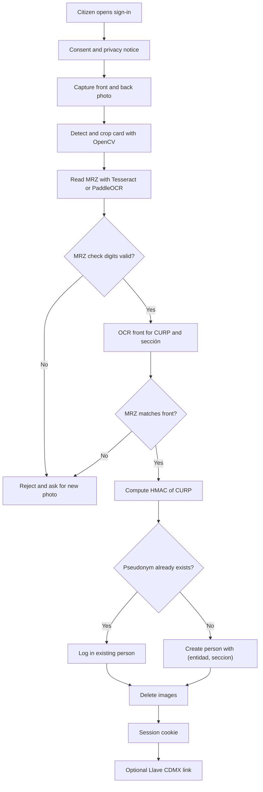

# Authentication: proving one person, one signature

Status: proposal. Scope: all of Ciudad de México (CDMX). Demo scope: the *alcaldía* (borough) Cuauhtémoc (2026-10-26).

## 1. Goal and constraints

Rogatio must prove two facts about each signer:

1. The signer is a real person with a valid *credencial para votar* (INE voter credential).
2. The signer signs each petition only one time.

Founder constraints:

- No commercial identity-verification vendor.
- We build our own OCR of the INE credential.
- All code is public and open source (AGPL-3.0). Security depends only on secret keys, not on secret code.
- Llave CDMX (the CDMX single sign-on) is an optional second factor.

## 2. MVP versus later

| Item | MVP (demo) | Later |
|---|---|---|
| INE input | Mock form: CURP, *clave de elector* (voter key), name, *sección electoral* (electoral section) | Photo of front and back |
| MRZ | Parse and validate check digits on typed or fixture MRZ text | OCR from photo |
| Pseudonym | `HMAC-SHA256(key, CURP)` | Same, key in a KMS |
| Front OCR, QR, cross-checks | No | Yes |
| INE validity check | No | INE agreement (section 4.6) |
| Liveness and face match | No | Stretch goal |
| Llave CDMX | Button stub only | Real link, if ADIP agrees |

## 3. INE credential anatomy

### 3.1 Current models

| Model | First issued | Valid in 2026 |
|---|---|---|
| A, B, C, D | 1992 to 2013 (IFE designs) | No |
| E, F | 2014, 2016 | Yes, until the printed *vigencia* (expiry) |
| G, H | December 2019 | Yes |
| I, J | June 2026 | Yes |

The odd letters are national cards. The even letters are cards issued abroad (to verify for I/J). Each card is valid for 10 years. The printed *vigencia* controls.

### 3.2 Fields

| Side | Field | Note |
|---|---|---|
| Front | *nombre* (name) | Full name |
| Front | *domicilio* (address) | Optional on request; often hidden |
| Front | CURP | 18 characters, national population key |
| Front | *clave de elector* | 18 characters, voter key |
| Front | *año de registro* (registration year) and *número de emisión* (issue number) | Issue number changes with each new card |
| Front | *sección* | 4 digits; gives the *alcaldía* and the districts |
| Front | *vigencia* | Expiry year |
| Back | MRZ (Machine Readable Zone) | 3 lines of 30 characters, ICAO 9303 TD1 |
| Back | QR codes | G/H: two QR codes with encrypted data, fingerprint and a digital signature, plus one small public QR. I/J: three QR codes |

MRZ line 1 starts with `IDMEX`. Then it holds:

- the 9-digit CIC (*Código de Identificación de la Credencial*, card code),
- a check digit,
- `<<`,
- the 13-digit *identificador ciudadano* (citizen ID, also called OCR).

Line 2 holds birth date, sex, expiry and check digits. Line 3 holds the name. The exact field positions are (to verify) against real cards.

The large QR codes are encrypted. Only the INE app can decrypt and verify them (to verify whether INE publishes a key). We can read the small public QR. We cannot use the QR codes as a cryptographic control.

### 3.3 Which field gives uniqueness

| Field | Scope | Changes when | Use |
|---|---|---|---|
| CURP | One person, for life (RENAPO) | Rarely (data correction) | **Primary dedup key** |
| *clave de elector* | One person in the voter roll | Rarely | Secondary dedup key |
| CIC | One physical card | Every new card | Validity check, not dedup |

We use CURP for the pseudonym. A person with a new card keeps the same CURP, so the person cannot sign again. CURP is also the key of Llave MX and Llave CDMX. CIC is bad for dedup: a person who requests a new card gets a new CIC.

## 4. Our pipeline (all open source)

### 4.1 Capture

The browser takes the photo. It shows a card frame and checks blur and glare on the device. We send the image over TLS only. We keep images in memory only.

### 4.2 Detection and crop

OpenCV finds the card edges and corrects the perspective. The output is a flat card image.

### 4.3 MRZ read

Options: PassportEye (Tesseract based), or PaddleOCR. We train or tune for the OCR-B font. We validate every ICAO check digit (weights 7, 3, 1). A failed check digit rejects the read. This step is deterministic and needs no AI.

### 4.4 Front OCR and cross-check

PaddleOCR reads the CURP and *sección* from the front. Then we compare:

- CURP format (18 characters, internal check digit).
- Birth date and sex in CURP against birth date and sex in MRZ.
- Name in MRZ against name on the front.
- `(entidad, seccion)` exists in the `electoral_sections` table.
- Expiry in MRZ is in the future.

All checks must pass.

### 4.5 Claude vision

Claude vision can help when OCR has low confidence. It can suggest field values. It is never the only control: every value it returns must pass the same check digits and cross-checks. Rogatio does not store the images that it sends to Claude. The retention terms of the API are (to verify).

### 4.6 INE validity check

The public page *Lista Nominal* (listanominal.ine.mx) checks one card at a time. It uses CIC and *identificador ciudadano*. INE built it for citizens, not for machines. We do not automate it or scrape it. We did not find public terms that allow programmatic use (to verify).

The official route is the INE *Servicio de Verificación de Datos de la Credencial para Votar* (Acuerdo INE/CG92/2016). It works through an agreement (*convenio*). The agreement text names *asociaciones civiles* as possible parties. The signer must give consent in the name of INE. Fees are in an annex (to verify). This is a later step for Rogatio A.C. INE is a public authority, not a commercial vendor, so this route respects the founder constraints.

## 5. Liveness and face match (stretch goal)

| Option | Tool | Weakness |
|---|---|---|
| Face match | InsightFace embeddings (ArcFace) | Code is MIT, but pretrained models are for non-commercial research only. We need a license or other weights |
| Active liveness | MediaPipe Face Landmarker: blink, turn head on a random prompt | A deepfake or a virtual camera can pass it |
| Passive liveness | Open-source anti-spoof models | Low accuracy on new attacks; demographic bias |

Why it is not MVP:

- Face templates are biometric data. The law gives them extra protection (section 7).
- Our tests cannot measure the false accept rate with confidence.
- The demo has 3 hours of build time.

## 6. Llave CDMX

Llave CDMX is the single sign-on of the ADIP (*Agencia Digital de Innovación Pública*). The *Gaceta Oficial* published its rules (*lineamientos*) on 2020-08-07. They cover login to digital channels of the CDMX government and the *alcaldías*.

What we found:

- The public site shows no developer documentation.
- A login URL path contains `oauthV2`. This suggests an OAuth server. It does not prove third-party access.
- The *lineamientos* target public offices. Access for a civil association is (to verify).

How to request: ask ADIP directly at the Impact Lab, then send a written request (to verify the correct channel).

Our position: Llave CDMX is an **optional second factor**. It proves a CDMX account linked to a CURP. We compare its CURP with the INE CURP through the HMAC. It never replaces the INE check. A person without Llave can still sign.

## 7. Privacy and law

Rogatio is a private party (*particular*). So the *Ley Federal de Protección de Datos Personales en Posesión de los Particulares* (LFPDPPP) applies. The DOF published this new law on 2025-03-20. It replaces the 2010 law. The *Ley General de Protección de Datos Personales en Posesión de Sujetos Obligados* (LGPDPPSO) applies to public bodies: ADIP, INE and the authorities that receive our petitions. It does not apply to Rogatio.

Important: the LFPDPPP lists *opiniones políticas* (political opinions) as sensitive data (Art. 2 fr. VI). A petition signature can show a political opinion. So we need express, written consent (Art. 8). Our proposal is a click on an explicit consent text in an authenticated session (to verify with counsel).

Rules:

- Publish an *aviso de privacidad* (privacy notice) with the content of Art. 15 before capture.
- Store in clear only: `curp_hmac`, `(entidad, seccion)` and `verified_at`.
- Store name and CURP encrypted. Use them only to generate the Art. 8 petition.
- Show only a truncated `curp_hmac` in public.
- Delete images after processing. Never log them.
- Keep the HMAC key outside the database and outside the repository.

## 8. Threat model

| Threat | Control |
|---|---|
| Fake or photocopied INE | MRZ check digits, MRZ to front cross-check, CURP to MRZ cross-check; later INE agreement and QR check |
| One person, many signatures | `UNIQUE(curp_hmac)` on persons and `UNIQUE(petition_id, person_id)` on signatures (table names to verify against the schema) |
| Stolen INE images (leaks are common) | Later: liveness and face match; Llave CDMX second factor; rate limits per *sección* |
| Bots | Rate limits, proof-of-work or CAPTCHA, alerts on sign-up spikes per *sección* |
| Insider at Rogatio | HMAC key in a KMS, encrypted names, audit log, append-only ledger, public code review |
| Brute force of pseudonyms | HMAC with secret key, not a plain hash (CURP is predictable) |

## Open questions

- Do we accept I/J cards in the demo fixtures, or only G/H?
- Is a click consent enough for sensitive data, or do we need an e-signature?
- Who asks ADIP about Llave CDMX access, and when?
- Do we sign an INE verification agreement after Rogatio A.C. exists?
- Which face model license is acceptable for a non-profit with AGPL code?

## Sources

- INE, [ABC de la Credencial para Votar (2022)](https://www.ine.mx/wp-content/uploads/2022/10/DERFEABCCREDENCIAL2022.pdf): models, fields, QR codes, MRZ.
- Expansión, [La nueva credencial INE (2026-08-20)](https://politica.expansion.mx/mexico/2026/08/20/la-nueva-credencial-ine-la-tuya-todavia-sirve-para-votar): models I/J and valid models.
- INE, [Acuerdo INE/CG92/2016](https://repositoriodocumental.ine.mx/xmlui/bitstream/handle/123456789/87473/CGor201602-26_ap_13.pdf): verification service.
- INE, [Consulta de la Lista Nominal](https://listanominal.ine.mx/scpln/).
- ICAO, [Doc 9303 Machine Readable Travel Documents](https://www.icao.int/publications/doc-series/doc-9303).
- Cámara de Diputados, [LFPDPPP](https://www.diputados.gob.mx/LeyesBiblio/pdf/LFPDPPP.pdf), [LGPDPPSO](https://www.diputados.gob.mx/LeyesBiblio/pdf/LGPDPPSO.pdf), [Constitución, Art. 8](https://www.diputados.gob.mx/LeyesBiblio/pdf/CPEUM.pdf).
- [Llave CDMX](https://llave.cdmx.gob.mx/), [ADIP](https://adip.cdmx.gob.mx/), [Gaceta síntesis 2020-08-07](https://www.supremacorte.gob.mx/sites/default/files/sintesis_dof_gocdmx/documento/2020-08/GOCDMX%2007082020%20BIS%20S%C3%8DNTESIS.pdf).
- Tools: [PassportEye](https://github.com/konstantint/PassportEye), [Tesseract](https://github.com/tesseract-ocr/tesseract), [PaddleOCR](https://github.com/PaddlePaddle/PaddleOCR), [OpenCV](https://github.com/opencv/opencv), [InsightFace](https://github.com/deepinsight/insightface), [MediaPipe Face Landmarker](https://ai.google.dev/edge/mediapipe/solutions/vision/face_landmarker).
