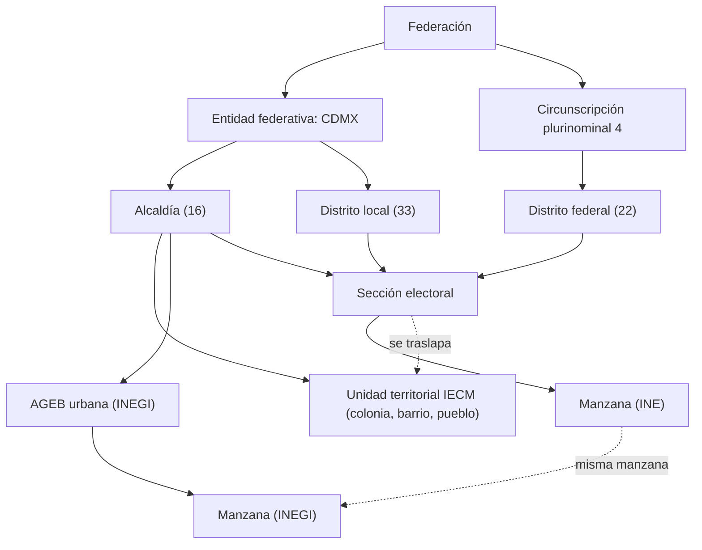

# Jurisdicciones y unidades territoriales

Estado: propuesta. Alcance: toda la Ciudad de México (CDMX). Alcance de la demo: la alcaldía Cuauhtémoc (2026-10-26).

Este documento describe las unidades territoriales de la CDMX. También define cómo las guarda Rogatio.

## 1. Dos árboles, un átomo

México divide su territorio de dos formas independientes:

1. **El árbol de gobierno.** Describe quién gobierna un lugar y quién debe responder una petición.
2. **El árbol electoral.** Describe quién representa a un votante en los congresos.

Los dos árboles no se anidan. Un distrito puede cruzar el límite de una alcaldía. Una colonia puede contener partes de varias secciones electorales. La manzana es la unidad más pequeña en ambos árboles. Es el átomo común.



## 2. Árbol de gobierno

| Nivel | Número en CDMX | Significado | Fundamento legal |
|---|---|---|---|
| Federación | 1 | Legal | Constitución (CPEUM) |
| Entidad federativa CDMX | 1 | Legal | CPEUM Art. 122 |
| Demarcación territorial / alcaldía | 16 | Legal | CPEUM Art. 122 |
| Unidad territorial (UT) | 1,837 en CDMX; 64 en Cuauhtémoc | Legal, solo para participación | Ley de Participación Ciudadana CDMX, Art. 2 |
| Colonia, barrio, pueblo | cerca de 34 colonias con nombre en Cuauhtémoc (por verificar) | Nombre administrativo, sin gobierno propio | Catálogos del IECM y la SEDUVI |
| AGEB (área geoestadística básica) | no se cuenta aquí | Solo estadístico | INEGI Marco Geoestadístico |
| Manzana | no se cuenta aquí | Solo estadístico | INEGI Marco Geoestadístico |

Notas:

- La alcaldía es el nivel más bajo con gobierno electo. En la demo, la Alcaldía Cuauhtémoc recibe la petición del Art. 8.
- La colonia **no** es la unidad más pequeña. El IECM (instituto electoral de la CDMX) divide las colonias grandes en varias UT, por ejemplo Roma Norte I, II y III. Una UT tiene solo dos funciones legales. Elige una Comisión de Participación Comunitaria. Recibe presupuesto participativo.
- AGEB y manzana no tienen significado legal. El INEGI las usa para el censo. Rogatio las usa solo para mapas y estadística.

## 3. Árbol electoral

| Nivel | Número en CDMX | Lo define |
|---|---|---|
| Circunscripción plurinominal | La CDMX está en la 4.ª de 5; la 4.ª tiene su sede en la CDMX | CPEUM Art. 53; INE |
| Distrito electoral federal | 22 desde la distritación 2021-2023 (antes: 24) | INE |
| Distrito electoral local (del Congreso CDMX) | 33 | INE |
| Sección electoral | 5,535 en CDMX; 389 en Cuauhtémoc (números 4523 a 4911) | LGIPE Art. 147 |
| Manzana (del INE) | no se cuenta aquí | Cartografía del INE |

Notas:

- Una sección tiene entre 100 y 3,000 electores (LGIPE Art. 147). Es la unidad más pequeña con significado electoral.
- Cada sección está completa dentro de una alcaldía, un distrito federal y un distrito local.
- En Cuauhtémoc, las secciones pertenecen a los distritos locales 9 y 12 (por verificar contra la cartografía del IECM).
- El archivo de datos abiertos asigna las secciones de Cuauhtémoc a los distritos federales 8 y 12. Estos valores usan los distritos de antes de 2023.
- La distritación vigente es el Acuerdo INE/CG875/2022. Rige las elecciones de 2024, 2027 y 2030. Cuauhtémoc se divide en dos distritos federales: el 12 (300 secciones, todo dentro de Cuauhtémoc) y el 2 (89 secciones de la franja norte, compartido con Gustavo A. Madero). Ver [03-representantes.md](03-representantes.md).
- La lista de secciones y su distrito federal está en [data/ine/secciones-cuauhtemoc.csv](../../data/ine/secciones-cuauhtemoc.csv). Sale del Catálogo de información geoelectoral del INE (archivo EDMSLM). Ese catálogo no trae el distrito local.
- Los números de secciones vienen de un archivo con fecha de corte 2020-12-31. Los números vigentes están (por verificar).

### La credencial del INE da la llave de unión

El Art. 156 de la LGIPE exige que cada credencial para votar contenga la entidad, el municipio, la localidad y la sección del elector.

- Los modelos anteriores de credencial imprimen estado, municipio y sección como campos separados.
- El modelo vigente omite estado, municipio y localidad como campos separados. Destaca la sección.
- Un número de sección es único solo dentro de una entidad. Por eso la llave es `(entidad, seccion)`. Para la CDMX el código de entidad es `09`.

A partir de `(09, seccion)` Rogatio encuentra la alcaldía, el distrito federal, el distrito local y las UT. La alcaldía da al alcalde y al Concejo. El distrito federal da a un diputado federal. El distrito local da a un diputado local. Por eso la sección es la llave de unión entre una persona y todos sus representantes territoriales.

## 4. Modelo de datos de Rogatio

### Decisión

Usar **una sola tabla `jurisdicciones` para los dos árboles** y **una tabla aparte `secciones_electorales` como puente**. No usar una tabla general de aristas tipadas.

```sql
CREATE TYPE nivel_jurisdiccion AS ENUM (
  'federacion', 'entidad', 'alcaldia', 'unidad_territorial',
  'circunscripcion', 'distrito_federal', 'distrito_local'
);

CREATE TABLE jurisdicciones (
  id             bigserial PRIMARY KEY,
  nivel          nivel_jurisdiccion NOT NULL,
  padre_id       bigint REFERENCES jurisdicciones(id),
  codigo         text NOT NULL,          -- clave oficial, p. ej. '09-015' o 'DL-12'
  nombre         text NOT NULL,
  geometria      geometry(MultiPolygon, 4326),
  configuracion  jsonb NOT NULL DEFAULT '{}',
  UNIQUE (nivel, codigo)
);

CREATE TABLE secciones_electorales (
  entidad              smallint NOT NULL,   -- 9 (código INE '09') para la CDMX
  seccion              integer  NOT NULL,
  alcaldia_id          bigint NOT NULL REFERENCES jurisdicciones(id),
  distrito_federal_id  bigint NOT NULL REFERENCES jurisdicciones(id),
  distrito_local_id    bigint NOT NULL REFERENCES jurisdicciones(id),
  distritacion         text NOT NULL,       -- versión de la distritación, p. ej. 'INE 2023'
  geometria            geometry(MultiPolygon, 4326),
  PRIMARY KEY (entidad, seccion)
);

CREATE TABLE secciones_unidades (          -- la sección se traslapa con la UT (muchos a muchos)
  entidad     smallint,
  seccion     integer,
  unidad_id   bigint REFERENCES jurisdicciones(id),
  parcial     boolean NOT NULL,
  PRIMARY KEY (entidad, seccion, unidad_id),
  FOREIGN KEY (entidad, seccion) REFERENCES secciones_electorales
);
```

Cada nodo tiene un padre **dentro de su propio árbol**:

| Nivel | Padre |
|---|---|
| `entidad` | `federacion` |
| `alcaldia` | `entidad` |
| `unidad_territorial` | `alcaldia` |
| `circunscripcion` | `federacion` |
| `distrito_federal` | `circunscripcion` |
| `distrito_local` | `entidad` |

### Justificación

1. **Una sola tabla mantiene un solo mecanismo de configuración.** `resolver_configuracion()` recorre `padre_id` de la misma forma para una alcaldía y para un distrito. Una petición a un diputado local hereda el umbral de la CDMX.
2. **Una sola tabla mantiene un solo destino de petición.** `peticiones.jurisdiccion_id` puede apuntar a cualquier nodo de cualquiera de los dos árboles.
3. **Los árboles no se anidan, así que un nodo no necesita un segundo padre.** La sección es la única unidad que pertenece a los dos árboles. La tabla puente expresa este hecho de forma directa.
4. **Las aristas tipadas agregan costo y no dan ganancia.** Una tabla general de aristas necesita consultas recursivas sobre tipos de arista mezclados. La tabla puente necesita una sola búsqueda indexada.
5. **La sección tiene otra forma.** Tiene 5,535 filas, una llave natural compuesta y ninguna configuración de petición. Es una tabla de consulta, no una jurisdicción.
6. **AGEB y manzana quedan fuera del modelo.** No tienen autoridad ni representante. Se cargan después solo si un mapa las necesita.

La tabla `representantes` ([03-representantes.md](03-representantes.md)) y la clave `enrutamiento` en `jurisdicciones.configuracion` ([02-enrutamiento.md](02-enrutamiento.md)) hacen referencia a estos nodos.

### Regla de elegibilidad

Una persona puede firmar una petición cuando el nodo destino es igual a un nodo de la sección de la persona, o es un ancestro de ese nodo. Se guarda la `(entidad, seccion)` de la persona, no los id de los nodos. Así, una distritación cambia una sola tabla, no a cada persona.

## 5. Fuentes de datos

| Nivel | Fuente | Formato | Licencia |
|---|---|---|---|
| Entidad, alcaldía, AGEB, manzana | [INEGI Marco Geoestadístico](https://www.inegi.org.mx/temas/mg/) | SHP | [Términos de Libre Uso de la Información del INEGI](https://www.inegi.org.mx/inegi/terminos.html): se permiten el uso comercial y la redistribución con atribución |
| Alcaldía, distritos locales, secciones (CDMX) | [Marco Geográfico Electoral, datos.cdmx.gob.mx](https://datos.cdmx.gob.mx/dataset/marco-geografico-electoral) | KML en RAR | CC-BY-4.0 |
| Distritos federales, secciones, manzanas del INE | [INE Cartografía Electoral](https://cartografia.ine.mx/) | SHP (por verificar) | (por verificar) |
| Unidades territoriales (colonias del IECM) con sus secciones | [Colonias del IECM 2022, datos.cdmx.gob.mx](https://datos.cdmx.gob.mx/dataset/colonias-del-iecm-2022) | SHP, diccionario XLSX | CC-BY-4.0 |

El archivo del IECM 2022 lista, para cada UT, las secciones completas y las parciales. Esto da `secciones_unidades` sin unión espacial.

## Preguntas abiertas

- ¿Quién se encarga de la actualización anual de los archivos del INE y del IECM cuando cambian los límites?

## Fuentes

- [CPEUM (Constitución), Arts. 8, 53 y 122, Cámara de Diputados](https://www.diputados.gob.mx/LeyesBiblio/pdf/CPEUM.pdf)
- [LGIPE, Arts. 147 y 156, Cámara de Diputados](https://www.diputados.gob.mx/LeyesBiblio/pdf/LGIPE.pdf)
- [Ley de Participación Ciudadana de la Ciudad de México, Art. 2 (copia en el TECDMX)](https://tecdmx.org.mx/wp-content/uploads/2023/09/06_LPCCDMX.pdf)
- [INE, ABC de la credencial para votar 2022](https://www.ine.mx/wp-content/uploads/2022/10/DERFEABCCREDENCIAL2022.pdf)
- [INE, Geografía electoral 2024 (4.ª circunscripción, sede en la CDMX)](https://ayuda.ine.mx/2024/assets/docs/elecciones/geografia-electoral.pdf)
- [INE, Distritación electoral](https://www.ine.mx/voto-y-elecciones/distritacion-electoral/)
- [Expansión: el INE justifica la distritación de la CDMX (de 24 a 22 distritos)](https://politica.expansion.mx/cdmx/2021/09/20/el-ine-justifica-el-plan-de-redistritacion-en-la-cdmx-tras-criticas-de-sheinbaum)
- [IECM](https://www.iecm.mx/) y [Congreso de la Ciudad de México](https://www.congresocdmx.gob.mx/)
- Los números de Cuauhtémoc (389 secciones, 64 UT, distritos locales 9 y 12) vienen de nuestro propio análisis de los dos archivos de datos.cdmx.gob.mx citados arriba.
