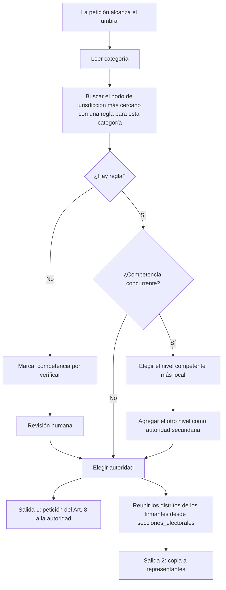

# Enrutamiento de peticiones: competencia por nivel

Estado: propuesta. Alcance: toda la Ciudad de México (CDMX). Alcance de la demo: la alcaldía Cuauhtémoc (2026-10-26).

## 1. Propósito

Este documento define cómo decide Rogatio a dónde va una petición.
La entrada es la **categoría** de la petición y el **territorio** de los firmantes.
La salida es una lista de destinatarios. Cada destinatario tiene un rol y un fundamento legal.

Este documento es la fuente de verdad para el destinatario del Art. 8. [03-representantes.md](03-representantes.md) selecciona a los representantes que reciben copia.

Rogatio produce dos salidas por cada petición que alcanza su umbral:

| Salida | Destinatario | Propósito | Efecto legal |
|---|---|---|---|
| 1. Petición del Art. 8 | La **autoridad** que puede actuar | Pedir una acción concreta | La autoridad debe responder por escrito en breve término (CPEUM Art. 8) |
| 2. Copia a representantes | Los **representantes** de los firmantes | Informar y pedir vigilancia | Sin obligación legal de responder |

El umbral es una regla del producto. La ley no exige un número mínimo de firmantes para una petición del Art. 8.

## 2. Fundamento legal

### 2.1 Derecho de petición

Los Arts. 8 y 35 fr. V de la CPEUM otorgan el derecho de petición (ver el [whitepaper](../whitepaper.md), sección 1.2). En materia política, solo los ciudadanos pueden pedir.

Consecuencia: la petición debe ir a la autoridad que tiene **competencia** (facultad legal) para actuar. Una autoridad equivocada da una respuesta válida: "no es de mi competencia". Los firmantes pierden entonces su esfuerzo.

### 2.2 Quién es competente

| Norma | Regla para el enrutamiento |
|---|---|
| CPEUM Art. 73 | Enumera las facultades del Congreso federal, p. ej. impuestos federales (fr. VII) y salubridad general (fr. XVI). |
| CPEUM Art. 124 | Las facultades no concedidas expresamente a los funcionarios federales corresponden a los estados o a la CDMX. |
| CPEUM Art. 115 | Regula a los municipios. **No** aplica a la CDMX. No lo cites en peticiones de la CDMX. |
| CPEUM Art. 122 | La CDMX es una entidad federativa autónoma. Las alcaldías gobiernan las demarcaciones territoriales. Sus facultades vienen de la Constitución de la CDMX y de las leyes locales (Art. 122 A fr. VI). |
| *Constitución Política de la CDMX* Art. 25 | Democracia directa. Apartado B: una iniciativa ciudadana necesita el 0.13% de la lista nominal de la CDMX. El 0.25% le da carácter preferente. No hay iniciativas en materia penal ni tributaria. |
| *Ley Orgánica de Alcaldías de la CDMX* (LOA) | Divide las facultades de la alcaldía en tres tipos: exclusivas (Arts. 30-39), coordinadas con el Gobierno de la CDMX (Arts. 40-57) y subordinadas al Gobierno de la CDMX (Arts. 58-61) (rangos de artículos por verificar contra el texto vigente). |
| *Ley de Participación Ciudadana de la CDMX* | Regula el procedimiento de la iniciativa ciudadana y la verificación de firmas del IECM (números de artículo por verificar). |

### 2.3 Facultades de la alcaldía para la demo

- **Exclusivas** (LOA Art. 32 fr. IV): alumbrado público, limpia y recolección de basura, poda de árboles, regulación de mercados y pavimentación.
- **Exclusivas** (LOA Art. 33): rehabilitar y mantener vialidades, guarniciones y banquetas en la alcaldía.
- **Exclusivas** (LOA Art. 34 fr. VI): construir y mantener los espacios públicos a su cargo, por ejemplo parques.
- **Coordinadas** (LOA Art. 42 fr. VII): obras de agua y drenaje, con el organismo de agua de la CDMX (SACMEX).
- **Subordinadas** (LOA Art. 61): seguridad pública. La alcaldía ejecuta la política y supervisa los mandos policiales locales. El Gobierno de la CDMX dirige a la policía.
- **Concejo** (LOA Art. 104): aprueba el presupuesto y los programas de la alcaldía. Opina sobre cambios de uso de suelo. Crea comisiones de vigilancia. Rogatio copia al Concejo como órgano representativo.

Las vialidades primarias corresponden a la Secretaría de Obras y Servicios (SOBSE) de la CDMX. Las vialidades secundarias corresponden a la alcaldía. La fuente legal de esta división es la *Ley de Movilidad* y el Art. 38 de la ley orgánica del poder ejecutivo de la CDMX (LOAPCDMX) (artículos exactos por verificar).

## 3. Tabla de enrutamiento

La columna de representantes muestra quién recibe copia. "Distrito de los firmantes" significa cada distrito que corresponde a la sección electoral de los firmantes.

| Categoría | Nivel | Autoridad (destinatario del Art. 8) | Representantes en copia | Fundamento | Estado |
|---|---|---|---|---|---|
| Baches, vialidades secundarias | Alcaldía | Alcaldía Cuauhtémoc (titular) | Concejo; diputado local del distrito de los firmantes | LOA Arts. 32 fr. IV, 33 | verificada |
| Baches, vialidades primarias | CDMX | SOBSE | Diputado local del distrito de los firmantes | Ley de Movilidad; LOAPCDMX Art. 38 | por verificar |
| Alumbrado público | Alcaldía | Alcaldía Cuauhtémoc (titular) | Concejo; diputado local | LOA Art. 32 fr. IV | verificada |
| Recolección de basura | Alcaldía | Alcaldía Cuauhtémoc (titular) | Concejo; diputado local | LOA Art. 32 fr. IV | verificada |
| Mercados | Alcaldía | Alcaldía Cuauhtémoc (titular) | Concejo; diputado local | LOA Art. 32 fr. IV | verificada |
| Parques, espacio público | Alcaldía | Alcaldía Cuauhtémoc (titular) | Concejo; diputado local | LOA Art. 34 fr. VI | verificada |
| Abasto de agua, drenaje | CDMX (concurrente) | SACMEX | Alcalde; diputado local | LOA Art. 42 fr. VII | por verificar |
| Seguridad pública | CDMX (concurrente) | Secretaría de Seguridad Ciudadana (SSC) | Alcalde; diputado local | LOA Art. 61 | por verificar |
| Metro | CDMX | Sistema de Transporte Colectivo (STC Metro) | Diputado local | Ley de Movilidad (por verificar) | por verificar |
| Metrobús | CDMX | Metrobús | Diputado local | Ley de Movilidad (por verificar) | por verificar |
| Uso de suelo | CDMX (concurrente) | SEDUVI | Alcalde; Concejo; diputado local | LOA Arts. 32 fr. VIII, 104 fr. IV | por verificar |
| Servicios de salud | Concurrente (federal y CDMX) | Secretaría de Salud de la CDMX | Diputado local; diputado federal | CPEUM Art. 73 fr. XVI | por verificar |
| Educación básica | Concurrente (federal y CDMX) | Autoridad educativa federal en la CDMX (por verificar) | Diputado federal; diputado local | CPEUM Art. 3, Art. 73 fr. XXV | por verificar |
| Impuestos federales | Federal | SHCP / SAT | Diputado federal; 3 senadores de la CDMX | CPEUM Art. 73 fr. VII | verificada |
| Leyes federales | Federal | Cámara de Diputados (vía la Mesa Directiva) y Senado | Diputado federal; 3 senadores de la CDMX | CPEUM Arts. 8, 71 fr. IV; Reglamento de la Cámara de Diputados Arts. 132-133 | verificada |
| Leyes locales | CDMX | Congreso de la CDMX | Diputado local; comisión competente (procedimiento por verificar) | Const. CDMX Art. 25 B | verificada |

Notas:

- La CDMX tiene 3 senadores: 2 por mayoría y 1 por primera minoría (CPEUM Art. 56).
- Una petición de una ley nueva es una petición del Art. 8, no una iniciativa ciudadana formal. Una iniciativa formal necesita el 0.13% de la lista nominal (federal: CPEUM Art. 71 fr. IV; CDMX: Const. CDMX Art. 25 B). Rogatio muestra la distancia a ese umbral solo como información.
- Los firmantes pueden vivir en más de un distrito. Rogatio envía una copia por distrito. Ver [03-representantes.md](03-representantes.md), sección 4.

## 4. Competencia concurrente o dudosa

Algunas categorías tienen más de un nivel competente. Aplica estas reglas en orden:

1. Envía la petición del Art. 8 al **nivel más local** que tenga una facultad legal en la materia.
2. Cita en el texto de la petición la norma que otorga esa facultad.
3. Copia al otro nivel competente como autoridad secundaria.
4. Si ninguna regla coincide, asigna `estado_competencia = "por_verificar"`. La plataforma muestra la marca "competencia: por verificar". Un revisor humano confirma el destinatario antes de que Rogatio envíe la petición.

La autoridad aún puede responder "no es de mi competencia". Rogatio registra entonces la respuesta. Ofrece reenviar la petición a la autoridad que la respuesta señale.

## 5. Flujo de decisión



## 6. Estructura de datos

### 6.1 Catálogo de categorías

Una tabla nueva `categorias` contiene el catálogo. No contiene datos de enrutamiento.

| Columna | Tipo | Ejemplo |
|---|---|---|
| `codigo` | text, PK | `vialidad.secundaria.bache` |
| `nombre` | text | Baches en vías secundarias |
| `codigo_padre` | text, admite nulo | `vialidad` |

### 6.2 Reglas de competencia en el árbol de jurisdicciones

Las reglas viven en `jurisdicciones.configuracion` (JSONB), bajo la clave `enrutamiento`. La resolución usa la misma regla que el resto de `configuracion`: **gana el nodo más cercano**. El resolvedor empieza en la jurisdicción de la petición y sube por el árbol hasta encontrar una regla. Una regla en el nodo CDMX aplica a las 16 alcaldías. Una regla en el nodo Cuauhtémoc la sustituye solo para Cuauhtémoc.

```json
{
  "enrutamiento": {
    "vialidad.secundaria.bache": {
      "nivel": "alcaldia",
      "autoridad": {"nombre": "Alcaldía Cuauhtémoc", "cargo": "Persona titular de la Alcaldía"},
      "autoridades_secundarias": [],
      "representantes": ["concejo", "congreso_cdmx"],
      "fundamento_legal": ["LOA art. 32 fr. IV", "LOA art. 33"],
      "estado_competencia": "verificada"
    }
  }
}
```

Los valores de `representantes` son valores de `representantes.camara` ([03-representantes.md](03-representantes.md)). El resolvedor selecciona al titular de cada distrito de los firmantes.

El resolvedor también acepta una regla en un código de categoría padre, por ejemplo `vialidad`. Una regla para el código exacto gana sobre una regla para un código padre.

### 6.3 Firma del resolvedor

```python
from typing import Literal
from pydantic import BaseModel

class Destinatario(BaseModel):
    rol: Literal["autoridad", "autoridad_secundaria", "representante"]
    nombre: str
    cargo: str
    jurisdiccion_id: int          # nodo dueño del cargo (alcaldía, CDMX, federación, distrito)
    fundamento_legal: list[str]   # p. ej. ["LOA art. 32 fr. IV"]
    num_firmantes: int | None     # solo representantes: firmantes en su distrito
    estado_competencia: Literal["verificada", "por_verificar"]

def enrutar(peticion: Peticion) -> list[Destinatario]:
    """Devuelve primero la autoridad, luego las autoridades secundarias y luego los representantes."""
```

`enrutar()` lee la regla de la categoría (sección 6.2). Luego lee las filas `(entidad, seccion)` de los firmantes en `secciones_electorales` para encontrar `alcaldia_id`, `distrito_federal_id` y `distrito_local_id`. Cuando la petición alcanza su umbral, Rogatio guarda el resultado con la petición. El PDF del Art. 8 usa el destinatario `autoridad`. Las copias usan los destinatarios `representante`.

## Preguntas abiertas

- ¿Quién revisa durante el piloto las peticiones con la marca "competencia: por verificar": el equipo o un abogado voluntario?
- ¿Rogatio copia a todos los representantes de todos los distritos de los firmantes, o solo a los distritos que superen una proporción mínima de firmantes?
- ¿Enviamos al Concejo como órgano (a través de la alcaldía) o a cada concejal por nombre?
- ¿Qué normas dan competencia sobre Metro, Metrobús, SACMEX y SOBSE? Un abogado debe confirmar los artículos exactos antes del lanzamiento.

## Fuentes

- *Constitución Política de los Estados Unidos Mexicanos* (Arts. 8, 35, 56, 71, 73, 115, 122, 124), Cámara de Diputados: https://www.diputados.gob.mx/LeyesBiblio/pdf/CPEUM.pdf
- *Ley Orgánica de Alcaldías de la Ciudad de México* (Arts. 19, 29-35, 40-42, 58-61, 104), copia alojada por la Alcaldía Iztacalco. Esta copia es el texto de 2018; revisa la versión consolidada vigente (por verificar): https://www.iztacalco.cdmx.gob.mx/pdf/normatividad/LEY_ORGANICA_ALCALDIAS_CDMX.pdf
- *Reglamento de la Cámara de Diputados* (Arts. 132-133): https://www.diputados.gob.mx/LeyesBiblio/pdf/Reg_Diputados.pdf
- *Constitución Política de la Ciudad de México*, Art. 25 (copia no oficial; cotejar con el texto del Congreso CDMX): https://leyes-mx.com/constitucion_ciudad_de_mexico/25.htm
- División entre vialidades primarias y secundarias (prensa, fuente secundaria): https://www.chilango.com/noticias/vias-primarias-secundarias-quien-debe-tapar-los-baches-en-la-cdmx/
- *Ley de Participación Ciudadana de la CDMX* y *Ley de Movilidad de la CDMX*: URL oficiales no confirmadas (por verificar).
