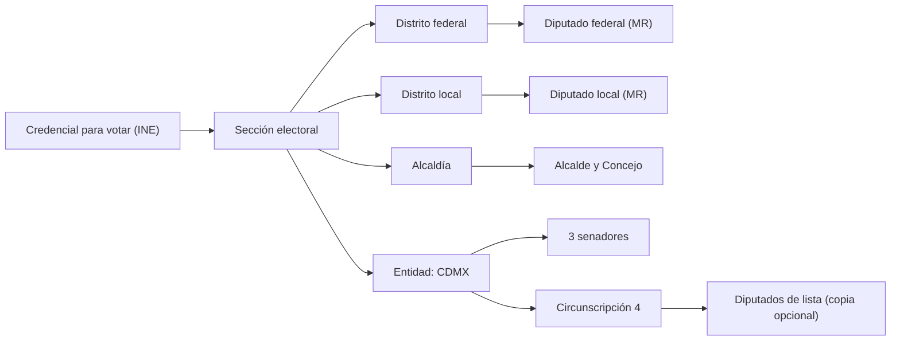

# Representantes: quién recibe la petición

Estado: propuesta. Alcance: toda la Ciudad de México (CDMX). Alcance de la demo: la alcaldía Cuauhtémoc (2026-10-26).

## 1. Propósito

Este documento define tres cosas:

- La lista de representantes electos que guarda Rogatio.
- La correspondencia entre la sección electoral de un firmante y esos representantes.
- La regla que elige qué representantes reciben copia de cada petición.

[02-enrutamiento.md](02-enrutamiento.md) elige al destinatario del Art. 8 (la autoridad). Este documento no cambia esa elección.

El Art. 8 de la CPEUM exige que la petición sea por escrito. La autoridad debe dar una respuesta por escrito. Por eso cada destinatario necesita un canal oficial de entrega verificado.

## 2. Quién representa a un habitante de la CDMX

| Cargo | Número | Principio de elección | Unidad territorial | Ley de origen |
|---|---|---|---|---|
| Diputado federal, mayoría | 300 | mayoría relativa | distrito federal | CPEUM Art. 52 |
| Diputado federal, lista | 200 | representación proporcional | circunscripción (5 regiones) | CPEUM Art. 52, 53 |
| Senador, por entidad | 3 por entidad | 2 de mayoría + 1 de primera minoría | entidad (CDMX) | CPEUM Art. 56 |
| Senador, lista nacional | 32 | lista proporcional | una circunscripción nacional | CPEUM Art. 56 |
| Diputado local (Congreso CDMX) | 66 | 33 de mayoría + 1 escaño migrante + 32 proporcionales | distrito local | Constitución de la CDMX Art. 29 |
| Alcalde | 1 por alcaldía | voto por planilla | alcaldía | Constitución de la CDMX Art. 53 |
| Concejal | 10, 12 o 15 por alcaldía (según población) | alrededor de 60% planilla, 40% proporcional (por verificar) | alcaldía | Constitución de la CDMX Art. 53 |

La CDMX pertenece a la circunscripción 4. La lista del SITL muestra a los diputados de lista de la CDMX como "Circ. 4". La CDMX tiene 22 distritos federales y 33 distritos locales ([01-jurisdicciones.md](01-jurisdicciones.md)).

### Cuauhtémoc en las legislaturas actuales

| Cargo | Unidad | Titular (2024-2027) | Evidencia |
|---|---|---|---|
| Diputado federal (LXVI) | Distrito federal 12 (300 secciones: centro y sur de Cuauhtémoc) | Mónica Elizabeth Sandoval Hernández | SITL, Wikipedia |
| Diputado federal (LXVI) | Distrito federal 2 (89 secciones: franja norte de Cuauhtémoc; también parte de Gustavo A. Madero) | José Alberto Benavides Castañeda | SITL, Wikipedia |
| Diputada local (III Legislatura) | Distrito local 9 (187 secciones) | Iliana Ivón Sánchez Chávez | Congreso CDMX |
| Diputada local (III Legislatura) | Distrito local 12 (202 secciones) | Leonor Gómez Otegui | Congreso CDMX |
| Alcaldesa | Cuauhtémoc | Alessandra Rojo de la Vega | Resultado del IECM (prensa) |
| Concejales | Cuauhtémoc | 15 escaños (por verificar; población 545,884) | Congreso CDMX, Expansión |

La cobertura de cada distrito sale de los catálogos del INE (corte de enero de 2026). La tabla por sección está en [data/ine/secciones-cuauhtemoc.csv](../../data/ine/secciones-cuauhtemoc.csv).

## 3. Correspondencia entre un firmante y sus representantes

La tabla `secciones_electorales` ya contiene `alcaldia_id`, `distrito_federal_id` y `distrito_local_id` ([01-jurisdicciones.md](01-jurisdicciones.md)). Una sola consulta da todos los representantes territoriales.

Reglas:

- La sección del INE es el único dato de entrada. Rogatio no pide domicilio.
- Una sección pertenece exactamente a un distrito federal y a un distrito local.
- Una redistritación cambia la correspondencia. La columna `secciones_electorales.distritacion` guarda la versión, por ejemplo `INE 2023`.

## 4. Qué representantes reciben copia

**Pregunta:** ¿copiar al diputado del distrito, al grupo parlamentario o a una comisión?

**Recomendación:**

1. **Copia principal: el diputado del distrito (mayoría relativa).** Este diputado representa el territorio del firmante. El número de firmantes le importa a esta persona.
2. **En solicitudes legislativas, llegar también a la comisión ordinaria competente.** El *Reglamento de la Cámara de Diputados* turna las peticiones a la Mesa Directiva (Art. 132). La Mesa Directiva turna las peticiones legislativas a la comisión competente (Art. 133). Las comisiones elaboran los dictámenes ([LOCGEUM Art. 39](https://www.diputados.gob.mx/LeyesBiblio/pdf/LOCGEUM.pdf)).
3. **Nunca enviar a un grupo parlamentario.** La ley lo define como "el conjunto de diputados según su afiliación de partido" (LOCGEUM Art. 26). Es un órgano partidista, no territorial. No tiene obligación de responder como autoridad. Una copia a él hace que Rogatio parezca partidista.

El tipo de petición decide el conjunto de destinatarios. La columna de destinatario del Art. 8 repite [02-enrutamiento.md](02-enrutamiento.md):

| Tipo de petición | Destinatario del Art. 8 (según 02-enrutamiento) | Representantes a copiar |
|---|---|---|
| Servicio de la alcaldía (pavimentación, alumbrado) | Alcaldía (titular) | Concejo; diputado del distrito local |
| Ley o presupuesto de la CDMX | Congreso de la CDMX | Diputado del distrito local; comisión competente del Congreso CDMX (procedimiento por verificar) |
| Ley federal | Cámara de Diputados (vía la Mesa Directiva, con solicitud de turno a la comisión) y Senado | Diputado del distrito federal; 3 senadores de la CDMX |
| Tema federal para toda la entidad, por ejemplo impuestos federales | Autoridad federal competente, por ejemplo SHCP / SAT | Diputado del distrito federal; 3 senadores de la CDMX |

### Firmantes en varios distritos

1. Agrupar las firmas verificadas por distrito.
2. Generar una copia por cada representante de distrito.
3. Cada copia indica el número de firmantes de ese distrito y el número total.
4. Aplicar el umbral al total. No aplicarlo por distrito.
5. Guardar un registro de entrega por copia.

Ejemplo: 800 firmantes en el distrito federal 12 y 120 en el distrito federal 2 dan dos copias. Cada copia muestra su propio número y el total de 920.

### Diputados de lista

Los diputados de lista (plurinominales) no tienen distrito. Rogatio los ofrece solo como copia opcional. El autor de la petición los selecciona. Valor predeterminado: desactivado.

## 5. Fuentes de datos

| Fuente | Datos | Formato | Método |
|---|---|---|---|
| Cámara de Diputados, SITL | 500 diputados federales, entidad, distrito o circunscripción, perfil con correo oficial | HTML | Extraer (scraping) las páginas de lista y de perfil |
| Senado | Senadores | HTML; existe una página de datos abiertos (contenido por verificar) | Extraer (scraping); revisar primero los datos abiertos |
| Congreso CDMX | Diputados locales por distrito y por lista proporcional | HTML | Extraer (scraping) dos páginas de lista |
| IECM | Resultados de alcaldes y concejales | Bases de datos de resultados (formato por verificar) | Descargar una vez por elección |
| Cartografía del INE | Correspondencia de sección a distrito, geometría | Cartografía descargable (formato por verificar) | Cargar en la carga inicial de datos |
| datos.cdmx.gob.mx | Alcaldías, colonias | CSV, GeoJSON (por verificar) | Cargar en la carga inicial de datos |

Ninguna fuente tiene una API pública verificada de representantes. Hay que planear la extracción (scraping).

### Tabla `representantes`

| Columna | Tipo | Nota |
|---|---|---|
| `id` | uuid | llave primaria |
| `camara` | enum | `diputados`, `senado`, `congreso_cdmx`, `alcaldia`, `concejo` |
| `legislatura` | text | `LXVI`, `III`, `2024-2027` |
| `principio` | enum | `mr`, `rp`, `primera_minoria`, `lista_nacional`, `planilla` |
| `jurisdiccion_id` | fk `jurisdicciones` | nodo `distrito_federal`, `distrito_local`, `alcaldia`, `entidad` o `circunscripcion`; `federacion` para senadores de lista nacional |
| `partido` | text | informativo; no se usa para el enrutamiento |
| `nombre` | text | |
| `correo_oficial` | text, null | solo dominio institucional |
| `domicilio_oficina` | text, null | domicilio de la oficialía de partes |
| `inicio_cargo`, `fin_cargo` | date | |
| `url_fuente` | text | página de la que salió la fila |
| `obtenido_en` | timestamptz | |

El enum `nivel_jurisdiccion` de [01-jurisdicciones.md](01-jurisdicciones.md) ya contiene `circunscripcion`. El Concejo no es una jurisdicción: las filas del Concejo apuntan al nodo `alcaldia` y usan `camara = concejo`. Los valores de `camara` son también los valores de `representantes` en las reglas de enrutamiento de [02-enrutamiento.md](02-enrutamiento.md).

### Tarea de actualización

- Correr cada semana, y cada día durante el primer mes de una legislatura.
- Comparar cada descarga con las filas guardadas. Escribir los cambios en una tabla `representantes_historial`.
- Marcar para revisión manual un cambio de titular, por ejemplo cuando un suplente ocupa el escaño.
- Antes de cada entrega, comprobar que `obtenido_en` tenga menos de 7 días.

## 6. Canales oficiales de entrega

Una petición del Art. 8 necesita una entrega por escrito y verificable.

- **El correo electrónico** va solo a la dirección institucional, por ejemplo `@diputados.gob.mx`. Es posible que el correo por sí solo no pruebe la recepción (por verificar).
- **La entrega física** va a la oficialía de partes de la cámara o de la alcaldía. El acuse de recibo es la prueba.
- El *Reglamento* exige nombre, rúbrica, domicilio y copia de identificación oficial para una petición (Art. 134). Rogatio debe definir quién firma como peticionario en una petición colectiva (por verificar).
- Rogatio guarda un hash de cada acuse en el registro de solo adición. El plazo de respuesta empieza en la fecha de entrega.

## Preguntas abiertas

- ¿Quién firma la petición del Art. 8 como peticionario legal: el autor, un representante legal o cada firmante?
- ¿El correo a una dirección institucional es una entrega válida del Art. 8, o presentamos en papel?
- ¿Qué distritos locales cubren exactamente Cuauhtémoc? Confirmar con el IECM antes de la demo.
- ¿Copiamos por omisión a los diputados de lista y a los senadores, o solo a petición?
- ¿Qué procedimiento del Congreso CDMX turna las peticiones ciudadanas a las comisiones?

## Fuentes

- [Constitución Política de los Estados Unidos Mexicanos (Arts. 8, 52, 53, 56)](https://www.diputados.gob.mx/LeyesBiblio/pdf/CPEUM.pdf)
- [Ley Orgánica del Congreso General (Arts. 26, 39)](https://www.diputados.gob.mx/LeyesBiblio/pdf/LOCGEUM.pdf)
- [Reglamento de la Cámara de Diputados (Arts. 132-134)](https://www.diputados.gob.mx/LeyesBiblio/pdf/Reg_Diputados.pdf)
- [SITL, LXVI Legislatura, lista completa de diputados](https://sitl.diputados.gob.mx/LXVI_leg/listado_diputados_gpnp.php?tipot=TOTAL)
- [Senado, senadores de la LXVI](https://www.senado.gob.mx/66/senadores) y [datos abiertos del Senado](https://www.senado.gob.mx/66/datosAbiertos/)
- Congreso CDMX: [diputadas](https://www.congresocdmx.gob.mx/diputadas-106-3.html), [diputados](https://www.congresocdmx.gob.mx/diputados-106-4.html)
- [Constitución Política de la Ciudad de México, Título Quinto (Art. 29)](https://mexico.justia.com/estatales/ciudad-de-mexico/constitucion-politica-de-la-ciudad-de-mexico/titulo-quinto/capitulo-i)
- [IECM](https://www.iecm.mx/), [cartografía del INE](https://cartografia.ine.mx/sige8/), [datos.cdmx.gob.mx](https://datos.cdmx.gob.mx/)
- Wikipedia: [distrito federal 12 de la Ciudad de México](https://en.wikipedia.org/wiki/12th_federal_electoral_district_of_Mexico_City), [distrito federal 2 de la Ciudad de México](https://en.wikipedia.org/wiki/2nd_federal_electoral_district_of_Mexico_City)
- [TECDMX-JEL-204/2024 (cómputo del distrito local 9)](https://www.tecdmx.org.mx/wp-content/uploads/2024/07/VERSION-DEFINITIVA-SENTENCIA-TECDMX-JEL-204-2024.pdf)
- [UnoTV: el IECM confirma el resultado en Cuauhtémoc](https://www.unotv.com/estados/ciudad-de-mexico/iecm-confirma-triunfo-de-alessandra-rojo-de-la-vega-en-alcaldia-cuauhtemoc/)
- [Expansión: concejales en la CDMX, 2024](https://politica.expansion.mx/elecciones/2024/06/15/morena-y-aliados-ganan-mas-concejalias-en-la-cdmx-tras-las-elecciones)
