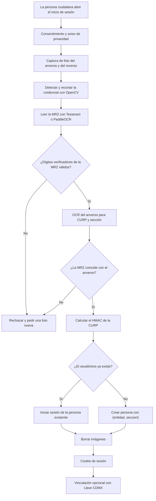

# Autenticación: probar una persona, una firma

Estado: propuesta. Alcance: toda la Ciudad de México (CDMX). Alcance de la demo: la alcaldía Cuauhtémoc (2026-10-26).

## 1. Objetivo y restricciones

Rogatio debe probar dos hechos sobre cada firmante:

1. El firmante es una persona real con una credencial para votar del INE válida.
2. El firmante firma cada petición una sola vez.

Restricciones del fundador:

- Ningún proveedor comercial de verificación de identidad.
- Construimos nuestro propio OCR de la credencial del INE.
- Todo el código es público y de código abierto (AGPL-3.0). La seguridad depende solo de claves secretas, no de código secreto.
- Llave CDMX (el inicio de sesión único de la CDMX) es un segundo factor opcional.

## 2. MVP frente a etapas posteriores

| Elemento | MVP (demo) | Después |
|---|---|---|
| Entrada del INE | Formulario simulado: CURP, clave de elector, nombre, sección electoral | Foto del anverso y del reverso |
| MRZ | Analizar y validar dígitos verificadores sobre texto MRZ capturado o de prueba | OCR desde la foto |
| Seudónimo | `HMAC-SHA256(clave, CURP)` | Igual, con la clave en un KMS |
| OCR del anverso, QR, verificaciones cruzadas | No | Sí |
| Verificación de vigencia ante el INE | No | Convenio con el INE (sección 4.6) |
| Prueba de vida y cotejo facial | No | Meta aspiracional |
| Llave CDMX | Solo un botón simulado | Vinculación real, si la ADIP acepta |

## 3. Anatomía de la credencial del INE

### 3.1 Modelos actuales

| Modelo | Primera emisión | Válido en 2026 |
|---|---|---|
| A, B, C, D | 1992 a 2013 (diseños del IFE) | No |
| E, F | 2014, 2016 | Sí, hasta la vigencia impresa |
| G, H | Diciembre de 2019 | Sí |
| I, J | Junio de 2026 | Sí |

Las letras impares son credenciales nacionales. Las letras pares son credenciales emitidas en el extranjero. Cada credencial tiene vigencia de 10 años. Manda la vigencia impresa.

Rogatio acepta solo credenciales vigentes: modelos E a J con la vigencia impresa sin vencer. Rechaza los modelos A a D y las credenciales vencidas.

### 3.2 Campos

| Lado | Campo | Nota |
|---|---|---|
| Anverso | nombre | Nombre completo |
| Anverso | domicilio | Opcional a solicitud; a menudo oculto |
| Anverso | CURP | 18 caracteres, clave única de registro de población |
| Anverso | clave de elector | 18 caracteres, clave de elector |
| Anverso | año de registro y número de emisión | El número de emisión cambia con cada credencial nueva |
| Anverso | sección | 4 dígitos; da la alcaldía y los distritos |
| Anverso | vigencia | Año de vencimiento |
| Reverso | MRZ (zona de lectura mecánica) | 3 líneas de 30 caracteres, ICAO 9303 TD1 |
| Reverso | Códigos QR | G/H: dos códigos QR con datos cifrados, huella dactilar y una firma digital, más un QR público pequeño. I/J: tres códigos QR |

La línea 1 de la MRZ empieza con `IDMEX`. Después contiene:

- el CIC de 9 dígitos (Código de Identificación de la Credencial),
- un dígito verificador,
- `<<`,
- el identificador ciudadano de 13 dígitos (también llamado OCR).

La línea 2 contiene fecha de nacimiento, sexo, vencimiento y dígitos verificadores. La línea 3 contiene el nombre. Las posiciones exactas de los campos están (por verificar) contra credenciales reales.

Los códigos QR grandes están cifrados. Solo la aplicación del INE puede descifrarlos y verificarlos (por verificar si el INE publica una clave). Podemos leer el QR público pequeño. No podemos usar los códigos QR como control criptográfico.

### 3.3 Qué campo da la unicidad

| Campo | Alcance | Cambia cuando | Uso |
|---|---|---|---|
| CURP | Una persona, de por vida (RENAPO) | Rara vez (corrección de datos) | **Clave principal de deduplicación** |
| clave de elector | Una persona en el padrón electoral | Rara vez | Clave secundaria de deduplicación |
| CIC | Una credencial física | Con cada credencial nueva | Verificación de vigencia, no deduplicación |

Usamos la CURP para el seudónimo. Una persona con credencial nueva conserva la misma CURP, así que no puede firmar otra vez. La CURP también es la clave de Llave MX y de Llave CDMX. El CIC no sirve para deduplicar: una persona que solicita una credencial nueva recibe un CIC nuevo.

## 4. Nuestro flujo de procesamiento (todo de código abierto)

### 4.1 Captura

El navegador toma la foto. Muestra un marco para la credencial y revisa desenfoque y reflejos en el dispositivo. Enviamos la imagen solo por TLS. Guardamos las imágenes solo en memoria.

### 4.2 Detección y recorte

OpenCV encuentra los bordes de la credencial y corrige la perspectiva. El resultado es una imagen plana de la credencial.

### 4.3 Lectura de la MRZ

Opciones: PassportEye (basado en Tesseract) o PaddleOCR. Entrenamos o ajustamos para la fuente OCR-B. Validamos cada dígito verificador ICAO (pesos 7, 3, 1). Un dígito verificador fallido rechaza la lectura. Este paso es determinista y no necesita IA.

### 4.4 OCR del anverso y verificación cruzada

PaddleOCR lee la CURP y la sección del anverso. Luego comparamos:

- Formato de la CURP (18 caracteres, dígito verificador interno).
- Fecha de nacimiento y sexo en la CURP contra fecha de nacimiento y sexo en la MRZ.
- Nombre en la MRZ contra nombre en el anverso.
- `(entidad, seccion)` existe en la tabla `secciones_electorales`.
- El vencimiento en la MRZ está en el futuro.

Todas las verificaciones deben pasar.

### 4.5 Visión de Claude

La visión de Claude puede ayudar cuando el OCR tiene baja confianza. Puede sugerir valores de campos. Nunca es el único control: cada valor que devuelve debe pasar los mismos dígitos verificadores y verificaciones cruzadas. Rogatio no guarda las imágenes que envía a Claude. Los términos de retención de la API están (por verificar).

### 4.6 Verificación de vigencia ante el INE

La página pública Lista Nominal (listanominal.ine.mx) consulta una credencial a la vez. Usa el CIC y el identificador ciudadano. El INE la hizo para la ciudadanía, no para máquinas. No la automatizamos ni la extraemos con scraping. No encontramos términos públicos que permitan su uso programático (por verificar).

La vía oficial es el Servicio de Verificación de Datos de la Credencial para Votar del INE (Acuerdo INE/CG92/2016). Funciona mediante un convenio. El texto del convenio nombra a las asociaciones civiles como posibles partes. El firmante debe dar su consentimiento a nombre del INE. Las tarifas están en un anexo (por verificar). Este es un paso posterior para Rogatio A.C. El INE es una autoridad pública, no un proveedor comercial, así que esta vía respeta las restricciones del fundador.

## 5. Prueba de vida y cotejo facial (meta aspiracional)

| Opción | Herramienta | Debilidad |
|---|---|---|
| Cotejo facial | Embeddings de InsightFace (ArcFace) | El código es MIT, pero los modelos preentrenados son solo para investigación no comercial. Necesitamos una licencia u otros pesos |
| Prueba de vida activa | MediaPipe Face Landmarker: parpadear, girar la cabeza ante una instrucción aleatoria | Un deepfake o una cámara virtual pueden pasarla |
| Prueba de vida pasiva | Modelos antisuplantación de código abierto | Baja precisión ante ataques nuevos; sesgo demográfico |

Por qué no está en el MVP:

- Las plantillas faciales son datos biométricos. La ley les da protección adicional (sección 7).
- Nuestras pruebas no pueden medir con confianza la tasa de falsa aceptación.
- La demo tiene 3 horas de construcción.

## 6. Llave CDMX

Llave CDMX es el inicio de sesión único de la ADIP (Agencia Digital de Innovación Pública). La *Gaceta Oficial* publicó sus lineamientos el 2020-08-07. Cubren el inicio de sesión en los canales digitales del gobierno de la CDMX y de las alcaldías.

Lo que encontramos:

- El sitio público no muestra documentación para desarrolladores.
- Una ruta de URL de inicio de sesión contiene `oauthV2`. Esto sugiere un servidor OAuth. No prueba acceso para terceros.
- Los lineamientos están dirigidos a dependencias públicas. El acceso para una asociación civil está (por verificar).

Cómo solicitarlo: preguntar directamente a la ADIP en el Impact Lab y luego enviar una solicitud por escrito (por verificar el canal correcto).

Nuestra postura: Llave CDMX es un **segundo factor opcional**. Prueba una cuenta de la CDMX vinculada a una CURP. Comparamos su CURP con la CURP del INE mediante el HMAC. Nunca sustituye la verificación del INE. Una persona sin Llave puede firmar de todos modos.

## 7. Privacidad y ley

Rogatio es un particular. Por eso aplica la *Ley Federal de Protección de Datos Personales en Posesión de los Particulares* (LFPDPPP). El DOF publicó esta nueva ley el 2025-03-20. Sustituye a la ley de 2010. La *Ley General de Protección de Datos Personales en Posesión de Sujetos Obligados* (LGPDPPSO) aplica a los organismos públicos: la ADIP, el INE y las autoridades que reciben nuestras peticiones. No aplica a Rogatio.

Importante: la LFPDPPP enumera las opiniones políticas como datos sensibles (Art. 2 fr. VI). Una firma en una petición puede mostrar una opinión política. Por eso necesitamos consentimiento expreso y por escrito (Art. 8). Nuestra propuesta es un clic sobre un texto de consentimiento explícito en una sesión autenticada (por verificar con asesoría legal).

Reglas:

- Publicar un aviso de privacidad con el contenido del Art. 15 antes de la captura.
- Guardar en claro solo: `curp_hmac`, `(entidad, seccion)` y `verificado_en`.
- Guardar nombre y CURP cifrados. Usarlos solo para generar la petición del Art. 8.
- Mostrar en público solo un `curp_hmac` truncado.
- Borrar las imágenes después del procesamiento. Nunca registrarlas en bitácoras.
- Guardar la clave HMAC fuera de la base de datos y fuera del repositorio.

## 8. Modelo de amenazas

| Amenaza | Control |
|---|---|
| INE falsa o fotocopiada | Dígitos verificadores de la MRZ, verificación cruzada de MRZ contra anverso, verificación cruzada de CURP contra MRZ; después, convenio con el INE y verificación del QR |
| Una persona, muchas firmas | `UNIQUE(curp_hmac)` en personas y `UNIQUE(peticion_id, persona_id)` en firmas (nombres de tablas por verificar contra el esquema) |
| Imágenes de INE robadas (las filtraciones son comunes) | Después: prueba de vida y cotejo facial; Llave CDMX como segundo factor; límites de frecuencia por sección |
| Bots | Límites de frecuencia, prueba de trabajo o CAPTCHA, alertas por picos de registros por sección |
| Persona interna de Rogatio | Clave HMAC en un KMS, nombres cifrados, bitácora de auditoría, registro de solo adición, revisión pública del código |
| Fuerza bruta sobre los seudónimos | HMAC con clave secreta, no un hash simple (la CURP es predecible) |

## Preguntas abiertas

- ¿Basta un consentimiento por clic para datos sensibles, o necesitamos una firma electrónica?
- ¿Quién pregunta a la ADIP sobre el acceso a Llave CDMX, y cuándo?
- ¿Firmamos un convenio de verificación con el INE una vez que exista Rogatio A.C.?
- ¿Qué licencia de modelo facial es aceptable para una organización sin fines de lucro con código AGPL?

## Fuentes

- INE, [ABC de la Credencial para Votar (2022)](https://www.ine.mx/wp-content/uploads/2022/10/DERFEABCCREDENCIAL2022.pdf): modelos, campos, códigos QR, MRZ.
- Expansión, [La nueva credencial INE (2026-08-20)](https://politica.expansion.mx/mexico/2026/08/20/la-nueva-credencial-ine-la-tuya-todavia-sirve-para-votar): modelos I/J y modelos vigentes.
- INE, [Acuerdo INE/CG92/2016](https://repositoriodocumental.ine.mx/xmlui/bitstream/handle/123456789/87473/CGor201602-26_ap_13.pdf): servicio de verificación.
- INE, [Consulta de la Lista Nominal](https://listanominal.ine.mx/scpln/).
- ICAO, [Doc 9303 Machine Readable Travel Documents](https://www.icao.int/publications/doc-series/doc-9303).
- Cámara de Diputados, [LFPDPPP](https://www.diputados.gob.mx/LeyesBiblio/pdf/LFPDPPP.pdf), [LGPDPPSO](https://www.diputados.gob.mx/LeyesBiblio/pdf/LGPDPPSO.pdf), [Constitución, Art. 8](https://www.diputados.gob.mx/LeyesBiblio/pdf/CPEUM.pdf).
- [Llave CDMX](https://llave.cdmx.gob.mx/), [ADIP](https://adip.cdmx.gob.mx/), [Gaceta síntesis 2020-08-07](https://www.supremacorte.gob.mx/sites/default/files/sintesis_dof_gocdmx/documento/2020-08/GOCDMX%2007082020%20BIS%20S%C3%8DNTESIS.pdf).
- Herramientas: [PassportEye](https://github.com/konstantint/PassportEye), [Tesseract](https://github.com/tesseract-ocr/tesseract), [PaddleOCR](https://github.com/PaddlePaddle/PaddleOCR), [OpenCV](https://github.com/opencv/opencv), [InsightFace](https://github.com/deepinsight/insightface), [MediaPipe Face Landmarker](https://ai.google.dev/edge/mediapipe/solutions/vision/face_landmarker).
