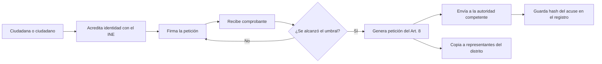

# Rogatio: peticiones ciudadanas verificadas para México

Estado: borrador. Fecha: 2026-10-20. Sitio: [rogatio.org](https://rogatio.org). Licencia: AGPL-3.0.

## Resumen

Rogatio es una plataforma de código abierto para peticiones ciudadanas en México. Cada firmante acredita su identidad con la credencial para votar del INE. Rogatio agrega cada firma a un registro de solo adición. El firmante recibe un comprobante criptográfico. Cuando una petición alcanza su umbral, Rogatio redacta una petición formal con base en el Art. 8 de la Constitución (una "petición del Art. 8"). Después la envía a la autoridad que puede actuar y marca copia a los representantes de los firmantes.

- Alcance del producto: toda la Ciudad de México (CDMX).
- Alcance de la demo: la alcaldía Cuauhtémoc, en el Claude Impact Lab en la Cámara de Diputados el 2026-10-26.

Rogatio no organiza votaciones ni mercados. Solo maneja peticiones.

## 1. El problema

### 1.1 Las listas en línea no prueban nada

Los sitios abiertos de peticiones recaban un nombre y un correo electrónico. No verifican identidad ni residencia (por verificar en cada plataforma). Una persona puede firmar muchas veces. Un bot puede firmar miles de veces. Una autoridad puede ignorar una lista así, y con frecuencia lo hace. La lista no tiene forma legal y nadie puede auditarla.

### 1.2 El derecho de petición es fuerte, pero difícil de ejercer en conjunto

El Art. 8 de la Constitución Política de los Estados Unidos Mexicanos (CPEUM) otorga a toda persona el derecho de petición. La petición debe formularse por escrito, de manera pacífica y respetuosa. La autoridad debe responder por escrito en breve término. El Art. 35 fr. V otorga a la ciudadanía el mismo derecho "en toda clase de negocios". La ley no exige un número mínimo de firmantes. Basta una persona.

El ejercicio colectivo es difícil:

- Una persona debe encontrar a la autoridad **competente**. Un destinatario equivocado responde "no es de mi competencia".
- Una persona debe presentar la petición y conservar el acuse de recibo.
- Un grupo debe reunir nombres e identificaciones en papel. Nadie puede verificar esa lista después.

Rogatio resuelve estos tres problemas con software.

## 2. El nombre

Una *rogatio* (plural *rogationes*) es un término jurídico romano. Es "una ley o decreto propuesto, un proyecto de ley" que se sometía al pueblo en las asambleas ([Lewis & Short, *rogatio*](https://www.perseus.tufts.edu/hopper/text?doc=Perseus:text:1999.04.0059:entry=rogatio)). La palabra viene de *rogare*, "preguntar" ([Lewis & Short, *rogo*](https://www.perseus.tufts.edu/hopper/text?doc=Perseus:text:1999.04.0059:entry=rogo)).

El magistrado hacía al pueblo una pregunta formal en los *comitia* (asambleas). La pregunta empezaba *Velitis, iubeatis, Quirites?* ("¿Lo quieren y lo ordenan, ciudadanos?"). Luego el pueblo aceptaba (*iubere*) o rechazaba (*antiquare*) el proyecto. Lewis & Short citan esta fórmula de Aulo Gelio (5.19.9). La primera *Encyclopaedia Britannica* describe el mismo procedimiento bajo *rogatio legis* ([EB 6.ª ed., 1823, réplica](https://jimclifford.ca/early_encyclopedia_britannica/articles/1823/eb_6th_1823_012926.html)).

El verbo español *rogar* tiene el mismo origen latino ([RAE, *rogar*](https://dle.rae.es/rogar); [Wiktionary, *rogar*](https://en.wiktionary.org/wiki/rogar)).

Rogatio invierte la dirección romana. En Roma, el magistrado preguntaba al pueblo. En Rogatio, el pueblo pregunta a la autoridad, y la autoridad debe responder.

## 3. Inspiración: peticiones del Parlamento del Reino Unido

El Parlamento del Reino Unido opera [petition.parliament.uk](https://petition.parliament.uk/help). Sus reglas actuales:

| Regla | Parlamento del Reino Unido |
|---|---|
| Quién puede firmar | Ciudadanos británicos y residentes en el Reino Unido |
| Antes de publicarse | 5 simpatizantes, luego una revisión de moderación |
| Periodo abierto | 6 meses |
| 10,000 firmas | El Gobierno da una respuesta por escrito |
| 100,000 firmas | El Comité de Peticiones evalúa la petición para un debate |
| Alcance | Solo asuntos nacionales; los asuntos locales van al concejo local |
| Moderación | [Estándares](https://petition.parliament.uk/standards) publicados |

Lo que Rogatio copia:

- Umbrales fijos y públicos que detonan una acción definida.
- Un paso de moderación antes de que una petición pueda reunir firmas.
- Conteos públicos y respuestas públicas en la página de la petición.

Lo que Rogatio cambia para México:

| Tema | Reino Unido | Rogatio |
|---|---|---|
| Operador | Parlamento (el destinatario) | Una asociación civil, independiente del gobierno |
| Identidad | Nombre, correo, código postal | Credencial del INE, una persona una firma |
| Efecto legal | Compromiso político | Petición del Art. 8 con obligación de responder |
| Nivel | Nacional | Alcaldía, CDMX y federal |
| Auditoría | Confiar en el operador | Comprobantes públicos y un registro de Merkle |
| Destinatarios | Gobierno y Parlamento | Autoridad competente más representantes del distrito |

## 4. Cómo funciona

1. **Identidad.** La persona captura los datos del INE. Rogatio verifica los dígitos de control de la MRZ (zona de lectura mecánica) y cruza los campos. La CURP (Clave Única de Registro de Población) da un seudónimo por persona de por vida. La demo usa un formulario simulado. El OCR de fotografía llega después. Ver [04-autenticacion.md](arquitectura/04-autenticacion.md).
2. **Elegibilidad.** La sección electoral del INE es la llave de unión. A partir de `(entidad, seccion)` Rogatio encuentra la alcaldía, el distrito federal y el distrito local. Una persona puede firmar una petición cuando su objetivo contiene su sección. Ver [01-jurisdicciones.md](arquitectura/01-jurisdicciones.md).
3. **Firma.** Rogatio agrega una hoja al registro de la petición. Una restricción de unicidad bloquea una segunda firma de la misma persona.
4. **Comprobante.** El firmante recibe el número de secuencia, el hash de la hoja, la raíz del árbol y una prueba de inclusión.
5. **Umbral.** El umbral es una regla del producto. La ley no lo exige. Cada nodo del árbol de jurisdicciones puede fijar su propio umbral. Gana el nodo más cercano.
6. **Petición del Art. 8.** Rogatio llena una plantilla con el texto de la petición, el fundamento legal, el número de firmantes y sus nombres. Produce un PDF.
7. **Enrutamiento.** La categoría de la petición determina la autoridad competente, por ejemplo la Alcaldía Cuauhtémoc para el alumbrado público. Una persona revisa los casos dudosos. Ver [02-enrutamiento.md](arquitectura/02-enrutamiento.md).
8. **Representantes.** Rogatio envía una copia por distrito. Cada copia indica el número de firmantes de ese distrito y el total. Los representantes no tienen obligación legal de responder. Ver [03-representantes.md](arquitectura/03-representantes.md).

## 5. Modelo de confianza

Rogatio no pide a nadie que confíe en el operador. Cualquiera puede verificar el sistema.

| Mecanismo | Qué prueba |
|---|---|
| Código abierto, [AGPL-3.0](https://www.gnu.org/licenses/agpl-3.0.html) | El código en ejecución es público. Una bifurcación que opere como servicio debe publicar sus cambios. |
| Registro de Merkle de solo adición | Rogatio no puede cambiar ni borrar una firma sin que cambie el hash raíz. El diseño sigue [Certificate Transparency (RFC 6962)](https://www.rfc-editor.org/rfc/rfc6962). |
| Comprobantes públicos | Cada firmante puede verificar su propia firma con la prueba de inclusión. |
| Seudónimos | La lista pública muestra un `curp_hmac` truncado = `HMAC-SHA256(clave, CURP)`. Un hash simple no es seguro porque la CURP es predecible. |
| Anclaje en [OpenTimestamps](https://opentimestamps.org/) (opcional) | El hash raíz se ancla en Bitcoin. Nadie puede antedatar ni reescribir el registro. |
| Hash del acuse guardado | El registro prueba la fecha de entrega. El plazo de respuesta corre desde esa fecha. |

La seguridad depende de claves secretas, no de código secreto.

Las líneas rojas de la asociación:

- Nada de dinero de partidos, candidatos ni campañas.
- Ninguna venta de datos, tampoco agregados.
- Ninguna petición patrocinada.
- Registros de financiamiento públicos.

## 6. Privacidad

Rogatio es un particular. Aplica la Ley Federal de Protección de Datos Personales en Posesión de los Particulares (LFPDPPP) de 2025. La ley considera las opiniones políticas como datos sensibles (Art. 2 fr. VI). Una firma puede revelar una opinión política. Por eso Rogatio pide consentimiento expreso y por escrito antes de la primera firma (Art. 8).

Reglas principales (lista completa en [04-autenticacion.md](arquitectura/04-autenticacion.md), sección 7):

- Publicar el aviso de privacidad antes de la captura.
- Borrar las imágenes del INE después de procesarlas. Nunca registrarlas en bitácoras.
- Guardar en claro solo `curp_hmac`, `(entidad, seccion)` y `verificado_en`.
- Cifrar el nombre y la CURP. Usarlos solo en la petición del Art. 8.
- Guardar la clave HMAC fuera de la base de datos y fuera del repositorio.

La petición del Art. 8 lleva los nombres de los firmantes, porque la autoridad responde a peticionarios identificados. El público solo ve conteos y seudónimos.

## 7. Alcance y hoja de ruta

| Fase | Alcance | Contenido |
|---|---|---|
| Demo (2026-10-26) | Alcaldía Cuauhtémoc: 389 secciones, 64 unidades territoriales | INE simulado, peticiones, registro, comprobantes, tablero, PDF del Art. 8 |
| Piloto | Cuauhtémoc | Peticiones reales, entrega real, respuestas reales |
| Producto | Toda la CDMX: 16 alcaldías, 5,589 secciones | OCR de fotografía, enrutamiento para todas las categorías, tarea de actualización de representantes |
| Después | Otros estados | Enrutamiento municipal (CPEUM Art. 115), congresos estatales |

Los conteos de secciones usan datos abiertos de 2020 (cifras vigentes por verificar).

Funciones posteriores:

- Convenio de verificación con el INE (Acuerdo INE/CG92/2016).
- Llave CDMX como segundo factor opcional.
- Un aviso cuando una petición se acerque al umbral formal de la iniciativa ciudadana de 0.13% de la lista nominal (CPEUM Art. 71 fr. IV; Constitución de la CDMX Art. 25 B).

## 8. Gobernanza

Una asociación civil, Rogatio A.C., opera la plataforma (por verificar: aún no constituida). El gobierno es destinatario de peticiones. Nunca es el dueño. Insitia Labs puede vender implementaciones del mismo motor abierto a otros clientes. Nunca controla la plataforma.

Razones de la independencia:

- Una plataforma que opera el gobierno es juez y parte. Los firmantes pierden la confianza.
- Una plataforma de gobierno puede terminar con la administración.
- La neutralidad es el activo principal. Un partido que pueda pagar para mover una petición la destruye.

Las decisiones siguen reglas públicas. Los estándares de moderación, los umbrales y la tabla de enrutamiento son archivos en el repositorio público. Un cambio a cualquiera de ellos es una solicitud de cambios pública con revisión.

Ver también [Transparencia](transparencia.md).

## Preguntas abiertas

- ¿Quién firma la petición del Art. 8 como peticionario legal: el autor, un representante legal o cada firmante?
- ¿El correo electrónico a una dirección institucional es una entrega válida del Art. 8, o presentamos en papel?
- ¿Basta un consentimiento con un clic para datos sensibles bajo la LFPDPPP?
- ¿Quién modera las peticiones y revisa la competencia dudosa durante el piloto?

## Fuentes

- [CPEUM, Arts. 8, 35, 71, 115, Cámara de Diputados](https://www.diputados.gob.mx/LeyesBiblio/pdf/CPEUM.pdf)
- [LFPDPPP, Cámara de Diputados](https://www.diputados.gob.mx/LeyesBiblio/pdf/LFPDPPP.pdf)
- [LGIPE, Cámara de Diputados](https://www.diputados.gob.mx/LeyesBiblio/pdf/LGIPE.pdf)
- [Acuerdo INE/CG92/2016](https://repositoriodocumental.ine.mx/xmlui/bitstream/handle/123456789/87473/CGor201602-26_ap_13.pdf)
- [Marco Geográfico Electoral, datos.cdmx.gob.mx](https://datos.cdmx.gob.mx/dataset/marco-geografico-electoral) y [Colonias del IECM 2022](https://datos.cdmx.gob.mx/dataset/colonias-del-iecm-2022)
- [INEGI Marco Geoestadístico](https://www.inegi.org.mx/temas/mg/)
- [Congreso de la Ciudad de México](https://www.congresocdmx.gob.mx/) y [Senado, senadores de la LXVI Legislatura](https://www.senado.gob.mx/66/senadores)
- [Peticiones del Parlamento del Reino Unido: ayuda](https://petition.parliament.uk/help) y [estándares](https://petition.parliament.uk/standards)
- [Lewis & Short: *rogatio*](https://www.perseus.tufts.edu/hopper/text?doc=Perseus:text:1999.04.0059:entry=rogatio) y [*rogo*](https://www.perseus.tufts.edu/hopper/text?doc=Perseus:text:1999.04.0059:entry=rogo), Perseus Digital Library
- [RAE, *rogar*](https://dle.rae.es/rogar); [Wiktionary, *rogar*](https://en.wiktionary.org/wiki/rogar)
- [Encyclopaedia Britannica, 6.ª ed. (1823), *rogatio*, réplica](https://jimclifford.ca/early_encyclopedia_britannica/articles/1823/eb_6th_1823_012926.html)
- [RFC 6962, Certificate Transparency](https://www.rfc-editor.org/rfc/rfc6962); [OpenTimestamps](https://opentimestamps.org/); [GNU AGPL-3.0](https://www.gnu.org/licenses/agpl-3.0.html)
- Arquitectura: [01-jurisdicciones](arquitectura/01-jurisdicciones.md), [02-enrutamiento](arquitectura/02-enrutamiento.md), [03-representantes](arquitectura/03-representantes.md), [04-autenticacion](arquitectura/04-autenticacion.md)
