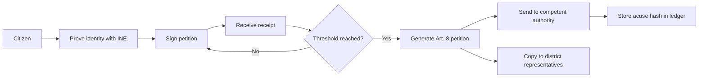

# Rogatio: verified citizen petitions for Mexico

Status: draft. Date: 2026-10-20. Site: [rogatio.org](https://rogatio.org). License: AGPL-3.0.

## Abstract

Rogatio is an open-source platform for citizen petitions in Mexico. Each signer proves their identity with the INE *credencial para votar* (voter credential). Rogatio adds each signature to an append-only ledger. The signer gets a cryptographic receipt. When a petition reaches its threshold, Rogatio writes a formal petition under Art. 8 of the Constitution (an "Art. 8 petition"). Rogatio then sends it to the authority that can act and copies the signers' representatives.

- Product scope: all of Ciudad de México (CDMX).
- Demo scope: the *alcaldía* (borough) Cuauhtémoc, at the Claude Impact Lab in the Cámara de Diputados on 2026-10-26.

Rogatio does not run votes or markets. It handles petitions only.

## 1. The problem

### 1.1 Online lists prove nothing

Open petition sites collect a name and an email address. They do not check identity or residency (to verify per platform). One person can sign many times. A bot can sign thousands of times. An authority can ignore such a list, and it often does. The list has no legal form, and nobody can audit it.

### 1.2 The right of petition is strong but hard to use together

Art. 8 of the *Constitución Política de los Estados Unidos Mexicanos* (CPEUM, federal Constitution) gives every person the right of petition. The petition must be written, peaceful and respectful. The authority must answer in writing *en breve término* (within a brief term). Art. 35 fr. V gives citizens the same right "in all kinds of matters". The law requires no minimum number of signers. One person is enough.

Collective use is hard:

- A citizen must find the **competent** authority. A wrong recipient answers "not my competence".
- A citizen must file the petition and keep the *acuse de recibo* (stamped receipt).
- A group must collect names and IDs on paper. Nobody can check that list later.

Rogatio solves these three problems with software.

## 2. The name

A *rogatio* (plural *rogationes*) is a Roman legal term. It is "a proposed law or decree, a bill" put to the people in the assemblies ([Lewis & Short, *rogatio*](https://www.perseus.tufts.edu/hopper/text?doc=Perseus:text:1999.04.0059:entry=rogatio)). The word comes from *rogare*, "to ask" ([Lewis & Short, *rogo*](https://www.perseus.tufts.edu/hopper/text?doc=Perseus:text:1999.04.0059:entry=rogo)).

The magistrate asked the people a formal question in the *comitia* (assembly). The question began *Velitis, iubeatis, Quirites?* ("Do you wish and order it, citizens?"). The people then accepted (*iubere*) or rejected (*antiquare*) the bill. Lewis & Short cite this formula from Aulus Gellius (5.19.9). The early *Encyclopaedia Britannica* gives the same procedure under *rogatio legis* ([EB 6th ed., 1823, mirror](https://jimclifford.ca/early_encyclopedia_britannica/articles/1823/eb_6th_1823_012926.html)).

The Spanish verb *rogar* (to ask, to beg) has the same Latin origin ([RAE, *rogar*](https://dle.rae.es/rogar); [Wiktionary, *rogar*](https://en.wiktionary.org/wiki/rogar)).

Rogatio reverses the Roman direction. In Rome, the magistrate asked the people. In Rogatio, the people ask the authority, and the authority must answer.

## 3. Inspiration: UK Parliament petitions

The UK Parliament runs [petition.parliament.uk](https://petition.parliament.uk/help). Its rules today:

| Rule | UK Parliament |
|---|---|
| Who can sign | British citizens and UK residents |
| Before publication | 5 supporters, then a moderation check |
| Open period | 6 months |
| 10,000 signatures | The Government gives a written response |
| 100,000 signatures | The Petitions Committee considers the petition for a debate |
| Scope | National matters only; local matters go to the local council |
| Moderation | Published [standards](https://petition.parliament.uk/standards) |

What Rogatio copies:

- Fixed, public thresholds that trigger a defined action.
- A moderation step before a petition can collect signatures.
- Public counts and public answers on the petition page.

What Rogatio changes for Mexico:

| Topic | UK | Rogatio |
|---|---|---|
| Operator | Parliament (the recipient) | A civil association, independent of government |
| Identity | Name, email, postcode | INE credential, one person one signature |
| Legal effect | Political commitment | Art. 8 petition with a duty to answer |
| Level | National | *Alcaldía*, CDMX and federal |
| Audit | Trust the operator | Public receipts and a Merkle ledger |
| Recipients | Government and Parliament | Competent authority plus district representatives |

## 4. How it works

1. **Identity.** The citizen enters the INE data. Rogatio checks the MRZ (machine-readable zone) check digits and cross-checks the fields. The CURP (national population key) gives one pseudonym per person for life. The demo uses a mock form. Photo OCR comes later. See [04-authentication.md](architecture/04-authentication.md).
2. **Eligibility.** The INE *sección electoral* (electoral section) is the join key. From `(entidad, seccion)` Rogatio finds the *alcaldía*, the federal district and the local district. A person can sign a petition when its target contains their *sección*. See [01-jurisdictions.md](architecture/01-jurisdictions.md).
3. **Signature.** Rogatio adds one leaf to the petition's ledger. A unique constraint blocks a second signature by the same person.
4. **Receipt.** The signer gets the sequence number, the leaf hash, the tree root and an inclusion proof.
5. **Threshold.** The threshold is a product rule. The law does not require it. Each node of the jurisdiction tree can set its own threshold. The closest node wins.
6. **Art. 8 petition.** Rogatio fills a template with the petition text, the legal basis, the signer count and the signers' names. It produces a PDF.
7. **Routing.** The petition category decides the competent authority, for example the Alcaldía Cuauhtémoc for street lighting. A human reviews unclear cases. See [02-routing.md](architecture/02-routing.md).
8. **Representatives.** Rogatio sends one copy per district. Each copy states that district's signer count and the total. Representatives have no legal duty to answer. See [03-representatives.md](architecture/03-representatives.md).

## 5. Trust model

Rogatio asks nobody to trust the operator. Anyone can check the system.

| Mechanism | What it proves |
|---|---|
| Open source, [AGPL-3.0](https://www.gnu.org/licenses/agpl-3.0.html) | The running code is public. A fork that runs as a service must publish its changes. |
| Append-only Merkle ledger | Rogatio cannot change or delete a signature without a change in the root hash. The design follows [Certificate Transparency (RFC 6962)](https://www.rfc-editor.org/rfc/rfc6962). |
| Public receipts | Each signer can check their own signature with the inclusion proof. |
| Pseudonyms | The public list shows a truncated `curp_hmac` = `HMAC-SHA256(key, CURP)`. A plain hash is not safe because the CURP is predictable. |
| [OpenTimestamps](https://opentimestamps.org/) anchoring (optional) | The root hash is anchored in Bitcoin. Nobody can backdate or rewrite the ledger. |
| Stored *acuse* hash | The ledger proves the delivery date. The answer term starts on that date. |

Security depends on secret keys, not on secret code.

The red lines of the association:

- No money from parties, candidates or campaigns.
- No sale of data, also not as aggregates.
- No sponsored petitions.
- Public funding records.

## 6. Privacy

Rogatio is a private party. The *Ley Federal de Protección de Datos Personales en Posesión de los Particulares* (LFPDPPP, federal data protection law for private parties) of 2025 applies. The law lists political opinions as sensitive data (Art. 2 fr. VI). A signature can show a political opinion. So Rogatio asks for express, written consent before the first signature (Art. 8).

Main rules (full list in [04-authentication.md](architecture/04-authentication.md), section 7):

- Publish the *aviso de privacidad* (privacy notice) before capture.
- Delete INE images after processing. Never log them.
- Store in clear only `curp_hmac`, `(entidad, seccion)` and `verified_at`.
- Encrypt the name and the CURP. Use them only in the Art. 8 petition.
- Keep the HMAC key outside the database and outside the repository.

The Art. 8 petition carries the names of the signers, because the authority answers identified petitioners. The public sees counts and pseudonyms only.

## 7. Scope and roadmap

| Phase | Scope | Content |
|---|---|---|
| Demo (2026-10-26) | *Alcaldía* Cuauhtémoc: 389 *secciones*, 64 *unidades territoriales* | Mock INE, petitions, ledger, receipts, dashboard, Art. 8 PDF |
| Pilot | Cuauhtémoc | Real petitions, real delivery, real answers |
| Product | All CDMX: 16 *alcaldías*, 5,535 *secciones* | Photo OCR, routing for all categories, representatives refresh job |
| Later | Other states | *Municipio* routing (CPEUM Art. 115), state congresses |

The *sección* counts use 2020 open data (current counts to verify).

Later features:

- INE verification agreement (Acuerdo INE/CG92/2016).
- Llave CDMX as an optional second factor.
- A notice when a petition nears the formal *iniciativa ciudadana* (citizen bill) threshold of 0.13% of the voter roll (CPEUM Art. 71 fr. IV; CDMX Constitution Art. 25 B).

## 8. Governance

A civil association, Rogatio A.C., operates the platform (to verify: not yet incorporated). The government is a recipient of petitions. It is never the owner. Insitia Labs can sell implementations of the same open engine to other clients. It never controls the platform.

Reasons for independence:

- A platform that the government runs is judge and party. Signers lose trust.
- A government platform can end with the administration.
- Neutrality is the main asset. A party that can pay to move a petition destroys it.

Decisions follow public rules. The moderation standards, the thresholds and the routing table are files in the public repository. A change to any of them is a public pull request with a review.

## Open questions

- Who signs the Art. 8 petition as the legal petitioner: the author, a legal representative, or each signer?
- Is email to an institutional address a valid Art. 8 delivery, or do we file on paper?
- Which threshold does the Cuauhtémoc demo use (proposal: 50)?
- Is a click consent enough for sensitive data under the LFPDPPP?
- Who moderates petitions and reviews unclear competence during the pilot?

## Sources

- [CPEUM, Arts. 8, 35, 71, 115, Cámara de Diputados](https://www.diputados.gob.mx/LeyesBiblio/pdf/CPEUM.pdf)
- [LFPDPPP, Cámara de Diputados](https://www.diputados.gob.mx/LeyesBiblio/pdf/LFPDPPP.pdf)
- [LGIPE, Cámara de Diputados](https://www.diputados.gob.mx/LeyesBiblio/pdf/LGIPE.pdf)
- [Acuerdo INE/CG92/2016](https://repositoriodocumental.ine.mx/xmlui/bitstream/handle/123456789/87473/CGor201602-26_ap_13.pdf)
- [Marco Geográfico Electoral, datos.cdmx.gob.mx](https://datos.cdmx.gob.mx/dataset/marco-geografico-electoral) and [Colonias del IECM 2022](https://datos.cdmx.gob.mx/dataset/colonias-del-iecm-2022)
- [INEGI Marco Geoestadístico](https://www.inegi.org.mx/temas/mg/)
- [Congreso de la Ciudad de México](https://www.congresocdmx.gob.mx/) and [Senado, LXVI senators](https://www.senado.gob.mx/66/senadores)
- [UK Parliament petitions: help](https://petition.parliament.uk/help) and [standards](https://petition.parliament.uk/standards)
- [Lewis & Short: *rogatio*](https://www.perseus.tufts.edu/hopper/text?doc=Perseus:text:1999.04.0059:entry=rogatio) and [*rogo*](https://www.perseus.tufts.edu/hopper/text?doc=Perseus:text:1999.04.0059:entry=rogo), Perseus Digital Library
- [RAE, *rogar*](https://dle.rae.es/rogar); [Wiktionary, *rogar*](https://en.wiktionary.org/wiki/rogar)
- [Encyclopaedia Britannica, 6th ed. (1823), *rogatio*, mirror](https://jimclifford.ca/early_encyclopedia_britannica/articles/1823/eb_6th_1823_012926.html)
- [RFC 6962, Certificate Transparency](https://www.rfc-editor.org/rfc/rfc6962); [OpenTimestamps](https://opentimestamps.org/); [GNU AGPL-3.0](https://www.gnu.org/licenses/agpl-3.0.html)
- Architecture: [01-jurisdictions](architecture/01-jurisdictions.md), [02-routing](architecture/02-routing.md), [03-representatives](architecture/03-representatives.md), [04-authentication](architecture/04-authentication.md)
